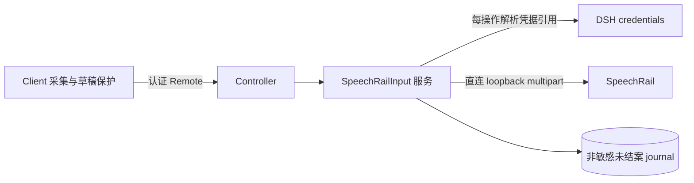

# 独立 SpeechRail DSH bundle 实施计划

> 依据：[设计 Draft 2](../specs/2026-10-23-speechrail-input-design.md)（已通过独立审查与用户批准）。本计划只做代码实现与 mock 验证；不激活当前 profile、不写入凭据、不使用真实麦克风或真实推理。

## 目标

交付 `@hrygo/dsh-speechrail-bundle`：一个可独立安装的 DSH bundle，用本机 SpeechRail 的 OpenAI-compatible 文件转写端点，把浏览器录音变成可编辑草稿。

## 架构

单一发布包 + 根最小 workspace。Host 面与 Client 面分开类型检查；Remote 元数据由官方 Typert generator 从源码生成。

## 技术栈

- TypeScript 6.0.x、tsdown 0.22.x、vitest 4.1.x、jsdom 29.x、React 18.3.x。
- DSH 包统一 `0.2.1-rc.2`；Cordis `~4.0.5`。
- 生成器：`@deepseek-ai/dsh-typert-generator@0.2.1-rc.2` 的 `./tsdown`。

## 规格来源

- 设计：[2026-10-23-speechrail-input-design.md](../specs/2026-10-23-speechrail-input-design.md)
- 选型：[ADR-0001](../../decisions/0001-independent-speechrail-input.md)
- 官方基线：[upstream/deepseek-harness](../../../upstream/deepseek-harness/)（只读参照）
- 审查记录：[2026-10-23-design-review.md](../../reviews/2026-10-23-design-review.md)

## 全局约束

- 只连数值 loopback `127.0.0.1`/`::1`；不继承代理、不跟随跳转；只用 `http`。
- 音频必须通过严格 16k/mono/PCM16 WAV 校验；上限 `min(4MiB, max_upload_bytes)` 与 `min(120s, max_audio_seconds)`。
- 凭据只按引用读取，不写入、不读取 SpeechRail 私有配置、不外泄到日志或错误。
- 结果不得包含原始响应体、路径或转写文本以外的隐私字段；错误用闭集码。
- `inferenceSeconds` 在任何情况下为 `null`；不得用墙钟时间填充。
- 单在途是 Host 全局、跨会话；首次 await 前同步占位；busy 立即返回，不排队。
- HTTP 在途必须先在 journal 写入 pending；硬中断后保持 `outcome-unknown`，不重放音频。
- 测试默认 mock 网络与合成音频；真实服务与 UI 自动化需要单独授权。
- 不修改 `upstream/`；派生文件标注来源。

## 审查重点

- Remote 严格输入是否真的在字段被默认 codec 剥除之前生效（须经 Remote 入口的 mock 集成测试）。
- journal 的 fail-closed 行为与按 operationId 清理是否覆盖在途卸载、损坏状态、迟到清理。
- 单在途 gate 是否真的在首次 await 前同步占位，并在所有路径释放。
- 错误与日志是否泄漏响应体、路径、密钥或转写文本。

## 任务

### 1. Workspace 与工具链门禁
- [ ] 根 `package.json`/`pnpm-workspace.yaml`/`tsconfig.base.json`/`tsconfig.host.json`/`tsconfig.client.json`
- [ ] 包骨架与 `tsdown.config.ts`（typertPlugin）
- [ ] `pnpm install` 成功，`tsc -b` 可用
- [ ] 验证：安装日志无未解析 peer；生成器可运行

### 2. 纯逻辑契约（测试优先）
- [ ] `endpoint.ts`：loopback URL 归一化与拒绝（含路径必须恰为 `/v1`）
- [ ] `wave.ts`：RIFF 长度、格式、时长校验
- [ ] `errors.ts`：闭集错误码与脱敏
- [ ] 验证：`vitest run tests/{endpoint,wave,errors}`

### 3. 配置、能力与凭据
- [ ] `config.ts`：字段范围、默认值、归一化
- [ ] `capabilities.ts`：能力快照投影，语言只在明确公布时开放
- [ ] `credentials.ts`：按引用解析，缺失即失败
- [ ] 验证：对应单测

### 4. Journal
- [ ] `journal.ts`：pending 写入、恢复 unknown、按 ID 清理、损坏 fail-closed
- [ ] 验证：内存与假 backend 测试，含“写入失败不发送”

### 5. HTTP 客户端
- [ ] `speechrail-client.ts`：multipart、认证、有界响应、计时、超时、取消
- [ ] 验证：假 fetch 测试，覆盖 401/404/400/5xx/超时/断连/畸形 JSON

### 6. Host 服务
- [ ] `service.ts`：gate、status、check、configure、transcribe、acknowledgeUnknown
- [ ] 验证：并发/取消/未知结果/重载恢复测试

### 7. Controller 与生成门禁
- [ ] `controller.ts`：@Remote 方法，JSON 字符串 carrier + 严格校验
- [ ] 验证：`./typert`、`./remote` 产物存在；`inferenceSeconds` 可空；Remote 入口 mock 拒绝未知字段

### 8. Client 采集
- [ ] `recording.ts`/`devices.ts`/`waveform`：16k WAV、flush、晚到权限、显式预览
- [ ] `store.ts`：会话草稿 revision 与冲突保留
- [ ] 验证：jsdom 测试

### 9. Client UI
- [ ] `VoiceInput.tsx`、`MicrophonePicker.tsx`、`Settings.tsx`、`mount.ts`、locale、CSS
- [ ] 验证：挂载/撤回、busy 态、错误本地化

### 10. 工具与补丁
- [ ] `tools/index.ts`：薄工具，复用服务方法
- [ ] `cordis.patch.yml`、`icon.svg`、locale 文件
- [ ] 验证：patch 只新增本包条目

### 11. 验证与审查
- [ ] 全量 `vitest run`、`tsc -b`、`tsdown` 构建
- [ ] 打包文件清单检查（不含音频、密钥、凭据）
- [ ] 独立审查并记录到 `docs/reviews/`

## 执行状态（2026-10-23）

已完成并验证：Host 核心（端点规范化、WAV 校验、能力快照、失败映射、journal、HTTP 多部分上传、gate 状态机）、Remote 控制器、插件入口、客户端面（录音、波形、输入控件、设置页、i18n）、Typert 工件生成、双面类型检查、双 bundle、打包清单检查。

更正（第二轮审查后）：客户端面**没有** jsdom 组件测试与 mount/withdraw 测试，自动化覆盖只有字典测试；此前的“已完成并验证”仅指构建、类型检查与字典测试。测试总数为 98（host 93 + client 5），新增 config/http-transport/remote-entry 三组回归测试。

按上文偏差 2、3 未实现：模型工具入口、麦克风设备选择器。按偏差 1 新增：`packages/typert-protocol` 垫片与等价性测试。

验证命令：`pnpm verify`（基线校验 → 生成 → 类型检查 → 双 bundle → 测试）、`pnpm --filter @hrygo/dsh-speechrail-bundle exec npm pack --dry-run`。

### 第三轮追加（2026-10-24）

已完成：薄 agent 工具 `speechrail_input_status`（只读、可选基础设施、结构化定义，避免 `dsh-tools` 声明牵入 `dsh-llm` 使 Typert 生成失败），`tests/tools.host.spec.ts` 6 项，测试总数 104（host 99 + client 5）。

仍未完成：客户端组件的 jsdom 测试、麦克风设备选择器、真实服务/真实麦克风验证、profile 激活。

### 第四轮追加（2026-10-24）

已完成：客户端组件 jsdom 测试（`voice-input.client.spec.tsx` 3 项），并修复测试暴露的确认按钮可达性缺陷（门禁阻塞且控件收起时也能确认）。测试总数 107（host 99 + client 8）。

### 第五轮追加（2026-10-24）

已完成：修复对抗性核验发现的 H1（工具输出 schema 不合注册表要求，工具从未注册）、H2（null 确认会抹掉真实未决记录）、H3（不可识别的 200 探测会放宽限额）、H4（random reset 测试替身不忠实）、H5（常量未真正删除）、H6（测试依赖生成产物）。新增 `tools/check-tool-schema.mjs` 对注册表真实断言做校验。测试总数 109（host 101 + client 8）。

### 第六轮追加（2026-10-24）

已完成：闭合 H3 残余（未声明的限额继承当前生效值，`previousLimits` 贯穿探测）、H2 残余（`null` 确认前重新读日志，客户端拒绝后刷新状态）、`check()` 端点拒绝分支的返回一致性、`tools.ts` 注释与 README 限额表述、核验脚本增加 `defineTool` 编译产物结构比对，并补一项客户端「拒绝后刷新状态」测试。测试总数 113（host 104 + client 9）。
