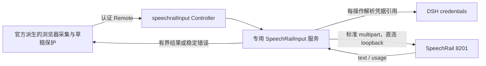

# 独立 SpeechRail DSH 语音输入 bundle 设计

- 版本：Draft 2，2026-10-23；尚未获得用户实施批准。
- 状态：Draft 2 已通过独立架构/安全审查与 Builder Checker 复核；等待用户批准，禁止自动实施。
- 审查记录：[审查与修订证据](../../reviews/2026-10-23-design-review.md)。
- 项目：`@hrygo/dsh-speechrail-bundle`（建议包名，不表示已经发布）。
- 官方基线：[来源清单](../../../upstream/baseline.json)，tag `dsh-v0.2.1-rc.2`，commit `687f282e8625c6b8d11ff58211a90524be2e4317`。
- 架构选项：[ADR-0001](../../decisions/0001-independent-speechrail-input.md)。

## 1. 用户目标与本轮交付

用户明确要求：以官方 bundle 为基础创建独立插件仓库，先建立官方基线，再设计重构和替代方案；方案审查通过后，经用户批准才实施。

本轮交付为本地 Git 仓库、不可变官方快照、方案、审查记录。没有产品运行源码、根安装入口或当前 profile 变更。未创建远程仓库，未推送。

“独立”定义为：自己的包名、Loader entry、设置页、服务、Remote namespace、locale 和浏览器偏好；只安装本包即可工作，不要求开启原官方 voice bundle。仍依赖 DSH 核心扩展服务，不复制整个 Harness。

## 2. 产品范围

### 目标

- 浏览器点击麦克风、明确授权、录音、停止后转写。
- SpeechRail 作为唯一后端；使用标准 OpenAI-compatible multipart 文件转写。
- 结果进入原会话草稿，不自动提交给 Agent。
- 保留官方设备选择、权限晚到清理、草稿 revision 冲突保护、取消与卸载资源释放行为。
- 在独立设置页显示本机连接状态、凭据是否配置、语言和非敏感参数。

### 非目标与反目标

- 不支持 Realtime/WS、流式字幕、TTS、分人、时间戳、唤醒词、常开麦克风或自动发送。
- 不提供任意 OpenAI 云后端、自动 fallback、多 provider registry 或模型目录。
- 不下载、加载、卸载模型；不管理 SpeechRail 服务、profile、worker 或版本。
- 不自动读取 SpeechRail 私有配置或复制密钥；不更改 DSH 全局 credentials provider。
- 不承诺 HTTP 取消立即停止后端；不把 readyz、状态检查成功或测试通过当成识别质量证明。
- 不与官方麦克风或其他 composer activity 强行抢同一席位，不自动关闭他人插件。

## 3. 推荐架构：专用薄切片 C



建议单一发布包，根仓库作最小 workspace，运行包位于 `packages/speechrail-input/`。这是为了容纳 Host/Client 编译面和官方公开 Typert generator 的 workspace 发现规则，不代表拆成多个发布产品。

运行链不依赖官方 `dsh-experimental-voice-input-bundle`、SenseVoice、sherpa 或原 STT/API 包。直接依赖 DSH 的核心 Cordis、Settings、Credentials、Storage、Tools、Typert/Remote 扩展点；Storage 仅保存非敏感未结案标记，不保存音频或密钥。

### 有限派生边界

| 官方来源 | 初版处理 | 必须保留或改变 |
|---|---|---|
| [audio.ts](../../../upstream/deepseek-harness/packages/experimental/client-ui-voice-input/src/client/audio.ts) | 有限派生 | 16k WAV、最后一块 flush、权限晚到、tracks 与 AudioContext 关闭 |
| [VoiceInput.tsx](../../../upstream/deepseek-harness/packages/experimental/client-ui-voice-input/src/client/VoiceInput.tsx) | 有限派生 | captureInsertion/insertText(span)、generation、冲突保留、onActiveChange 复位 |
| [设备组件](../../../upstream/deepseek-harness/packages/experimental/client-ui-voice-input/src/client/MicrophonePicker.tsx) | 简化重构 | 设备缺失不静默换输入；改为显式点击才开始电平预览 |
| [Waveform.tsx](../../../upstream/deepseek-harness/packages/experimental/client-ui-voice-input/src/client/Waveform.tsx) | 有限派生 | 动画取消与无障碍标签 |
| [wave.ts](../../../upstream/deepseek-harness/packages/experimental/speech-to-text/src/wave.ts) | 精确保留校验行为 | 严格 RIFF 长度、16k/mono/PCM16 与时长校验 |
| 原 registry、PreparationCard、SetupPrompt、下载器 | 不进入产品 | 移除与单一外部服务无关的多 provider / 安装准备状态 |
| 原 controller 与 Transcript | 不直接复用 | 新契约表达未知推理耗时与结构化错误 |
| UI primitives/client-store/CSS | 自有有限控件和 store | 不运行时 import Harness Client 内部包；使用 React 与 alias tokens |

“删除”仅指未来产品中不引入这些分支；只读上游快照保持不变。派生文件附上游路径和版权，不改官方来源元数据冒充新包。

### 为何不选 B

B 可独立组合原 STT Service/API 并 fork Client，但[官方 Transcript](../../../upstream/deepseek-harness/packages/experimental/speech-to-text/src/types.ts#L107-L124) 要求 measured inferenceSeconds:number；SpeechRail JSON 没有该值。[原 controller](../../../upstream/deepseek-harness/packages/experimental/api-speech-to-text/src/index.ts#L89-L109) 还把结构化异常压成普通 message。

将 HTTP 耗时塞进 inferenceSeconds 或加 side-channel 会保留错误语义与多余状态。C 的初始构建工作更多，但删去这些长期适配点。本结论是契约判断，不声称原 JSON 路径实测一定拒绝 null。

## 4. 身份、共存和配置所有权

- 包名：`@hrygo/dsh-speechrail-bundle`；建议初始版本 `0.1.0`。
- Host entry：`speechrail-input`；服务与 wire namespace：`speechrailInput`。
- Tool entry：`speechrail-input-tools`，指向本包 `./tools`；只包装同一 Host 方法。
- 设置页 keyed slot：本包全名；locale：`speechrail-input`；浏览器偏好键：`dsh.speechrail-input.microphone`。
- composer 使用现有 `conversation.input.activity` 单席位，不改 shell 或 DOM。
- 安装前显式检查官方 UI/其他 activity 互斥。本 Client 在 `slots.inject` 的声明生命周期回调中，经公开 `ctx.slots.spec/entries` 检查 single 声明与全部 raw occupants；有占用、API不可用或注册失败时仅拒绝/回滚自己的麦克风，设置页显示冲突，不改变其他 entry。无占用时同步按默认priority=0注册，不用priority shadow。
- 用 `ctx.slots.subscribe` 观察后续成功注册的foreign occupant，出现时撤回自己并取消采集；不自动重抢，需用户显式重新尝试。订阅是microtask-batched，不是原子租约；后到同priority插件可能先被框架拒绝，故不承诺任意安装顺序下自动仲裁或零冲突。`slots.inject` 本身只跟踪声明，不监视占用。公开委托方法见 [SlotRegistry](</Applications/DeepSeek Harness.app/Contents/Resources/app.asar/dsh/node_modules/@deepseek-ai/dsh-client-ui-renderer/lib/client.js#L1537-L1601>)。
- 独立 namespace 不是 UI 共存方案；首版官方/专用麦克风互斥。
- 不需要引入 service isolate；本包只有一个专用实例。若后续多实例，再单独设计。

持久化配置归本包 entry，通过 `ctx.settings.update` 和 revision 检查写入。读取时投影安全字段，禁把完整 credential source 路径返回网页或工具。

## 5. SpeechRail HTTP 契约

### 固定子集

```text
POST {baseUrl}/audio/transcriptions
file = recording.wav（完整 canonical 16k mono PCM16 WAV）
model = speechrail/qwen3-asr-1.7b
response_format = json
language = zh | en；auto 时省略
Authorization = Bearer <仅 Host 内存中解析>
```

由 FormData/HTTP 实现生成 multipart boundary，不手写 Content-Type。baseUrl 默认 `http://127.0.0.1:8201/v1`。

只允许 http 的数值 loopback：`127.0.0.1` 或 `::1`，显式合法端口，路径恰为 `/v1`（可规范化单个尾斜杠）；拒绝其他 hostname、userinfo、query、fragment、任意路径、跳转和远程地址。localhost 不做 DNS 特例。传输使用明确直连 dispatcher，不继承 HTTP proxy；不允许把本机 key 经代理或 redirect 发走。

初版 model 固定上述 canonical ID。语言候选为 `auto/zh/en`，但 `auto` 始终只表示省略 language；只有能力快照明确公布 supported 且 values 包含精确 hint 时才开放 zh/en。语言域 unknown 时只开放 auto；若已保存 zh/en 而后来不再有证据，拒绝开始并提示用户改选，绝不静默切换。当前源码语言枚举为 unknown，不阻断默认 auto 的文件转写。不镜像模型目录，也不透传 `zh-CN`。

成功响应必须验证 text:string 和 usage:{type:"duration",seconds:有限非负数}。允许空字符串作为无识别正文；不 trim 或重写非空正文。audioSeconds 以已经验证的 WAV 帧数为准；不请求时间戳，不以缺字段的其他服务响应冒充已验证 SpeechRail。

### 插件自己的结果契约

```ts
interface TranscriptionResult {
  text: string;
  audioSeconds: number;
  requestSeconds: number;
  inferenceSeconds: number | null;
}
```

requestSeconds 用 Host monotonic clock 测量出站请求开始至响应正文校验完成，包含 HTTP、排队、冷启动与推理。当前 inferenceSeconds 恒为 null，表示标准响应没有提供；绝不填 0 假装测得，也不宣传 requestSeconds 为纯推理性能。UI 不必展示计时；诊断可显示“请求耗时”。

## 6. 配置、凭据与检查

| 字段 | 默认与约束 | 更改行为 |
|---|---|---|
| baseUrl | `http://127.0.0.1:8201/v1`；第5节的数值回环规则 | 无在途任务时保存，随后状态 unknown |
| language | `auto`；zh/en 仅在能力明确枚举时允许 | 下次录音生效；unknown 仅允许 auto |
| apiKeyRef | `SPEECHRAIL_API_KEY`；POSIX 标识符 | 下次操作重新 resolve；不缓存密钥 |
| requestTimeoutMs | 150000；1000..180000 | 覆盖凭据、preflight、上传、等待和body的绝对总预算；修改仅影响新请求 |
| checkTimeoutMs | 3000；1000..10000 | 单次只读探针上限 |
| maxAudioBytes | 固定 4194304 | 不提供可调放大入口 |
| maxDurationSeconds | 固定 120 | 同时遵守服务更严格限制 |
| maxResponseBytes | 固定 262144 | Content-Length 提前检查，并累计读取字节上限 |

读取现有 `ctx.credentials.resolve(credentialRef(apiKeyRef))`；每操作重新解析，缺失则 fail-closed。不会调用 set/unset、自动解析 SpeechRail 私有 .env、生成新 key 或写入普通 Settings。

**现有 DSH credentials-local 是受限权限的明文文件，不是 Keychain。** 复用既有引用与新增密钥保存不是一回事。若引用尚未配置，设置页只提示用户选择既有 DSH 凭据路径；任何新增落盘都要用户明确决定。本方案不实现新的密钥保存表单，也不更改 credentials provider。

### 检查状态

状态由专用 discriminated union 表达：`unknown/checking/ready/unavailable/auth-required/incompatible/conflict/busy/draining/outcome-unknown`，不挪用原模型准备阶段的 standby/unprepared。

首次启用只注册能力；不自动采集、调用推理或检查。用户点击“检查连接”触发认证 GET `{baseUrl}/speechrail/capabilities`，在一个 checkTimeoutMs 预算内完成。没有轮询、GET自动重试或 readyz fallback。

有效快照必须满足：schema_version 精确为 `effective_capabilities_v1`；`operations.transcription.status === 'supported'`；`operations.transcription.output.formats` 含 json；`operations.transcription.input.max_upload_bytes`、`.max_audio_seconds` 是有限正数。没有 `.available` 或 `.ready` 公开字段，不能猜字段。

读取 `operations.transcription.languages.status/values`。supported 时只开放 values 与 zh/en 的精确交集；unknown 时保留事实、只开放 auto，不把语言域 unknown 偷换成整个 ASR 不可用。401 显示 auth-required；未知 schema/缺字段/非法限额显示 incompatible；supported 以外显示 unavailable。能力服务自身故障不能推断 ASR 模型已坏。

这些嵌套字段来自 [SpeechRail 当前 builder](</Users/hrygo/Documents/SpeechRail/src/speechrail/application/capability_snapshot.py#L328-L376>)，OpenAPI 对 operations 为开放对象；因此必须有专用投影测试，不声称机器契约已完整枚举。

有效录音上限取 `min(4194304, max_upload_bytes)` 与 `min(120, max_audio_seconds, (有效字节上限-44)/32000)`，按完整PCM帧向下取整。不能容纳至少一个PCM帧则 unavailable。将两项有效上限随 status 发给 Client，计时器/编码截断与 Host 校验共用；服务限额更小不静默超限。

检查结果只表示当时路由可用性，缓存最长30秒且绑定规范化端点、配置revision和凭据引用上下文。录音前过期则只读刷新，失败不开始麦克风；每次真正POST前重新解析凭据并重做能力检查，服务或语言变化时不上传。配置/已知凭据更新使缓存失效；不跨认证上下文复用304。检查不能清除 draining/outcome-unknown，也不证明前一请求完成，不触发模型准备或服务管理。

## 7. 生命周期、取消和并发

### 录音与隐私

设置页默认只列设备，不申请麦克风。用户明确点击“测试麦克风”才采集电平；预览不录制、不上传，并在隐藏、离页、换设备、卸载时释放。录音开始前给出权限；许可晚于取消到达时立即 stop tracks。

停止后等待 MediaRecorder 最后一块，再解码并输出 16k WAV。采集数据仅在内存，转写后释放；不生成音频附件、不写 Session 事件、不记录音频/base64/正文。实际用户提交草稿才进入普通消息链。

捕获 span 与会话 generation；会话切换、取消、卸载后迟到结果不能插入。草稿 revision 变化时保留结果供显式插入/丢弃，不覆盖用户编辑，不自动发送。

### 一个本地在途任务

Host-wide、跨 tab/session 的 gate 在第一个 await 前同步 claim，覆盖检查、HTTP 请求、body 校验与清理。第二个转写立即返回 busy，不排队、不抢占。只保证本插件的本地在途数，不保证其他 SpeechRail 客户端或服务端总并发。

转写发出后用户取消：立即停止 UI 插入、释放麦克风，Host 保持原 POST 在有限总 deadline 内 drain；服务状态为 draining，新转写拒绝。正常响应或明确终态错误到达后丢弃结果并释放 gate。Remote caller 取消不应把同一音频重发。

硬超时、网络中断或卸载强制中止本地 transport：结束本地资源所有权，但远端完成情况为 outcome-unknown；禁止自动重试和后台重放。界面明确提示“服务可能仍在处理”。只读检查不能清除该状态；用户主动开始全新录音前须单独确认该风险，才建立新意图，不重用旧音频。确认不是后端已释放的证据。

### 跨卸载/重启的未结案标记

首次 POST 前，必须先把 `{operationId, phase:'pending', createdAt}` 持久化到本包自有、profile稳定命名的 journal；成功后才发送音频。只保存非敏感元数据，绝不保存音频、base64、正文、密钥或请求重放材料。写入失败则不POST。

使用已核实的 `ctx.storage.backend.get('json').kv.open(...)`，descriptor 采用本包稳定unit名、version=1、tables=[]、hasGlobal=true、layout='single'；当前 json backend 的每次成功写入为 durable。不要选把坏记录当不存在的 per-record 形式。Backend缺失、journal读写失败、格式未知/损坏均 fail-closed，不把异常当首次空记录；单profile仅支持一个DSH Host写入者，不声称具备跨进程锁。

新服务实例必须在接受 check/POST 之前读取journal。存在任何未结案ID则直接恢复 outcome-unknown，检查成功也不能清除。正常HTTP终态或用户 `acknowledgeUnknown` 才能按当前operationId比对后清除；所有写入由同一Host串行化，迟到的旧ID不得清除新记录。硬中断保留标记，卸载/重装不删除journal。清理写入失败也保留unknown。此处只处理有限操作元数据，不构建通用jobs/恢复框架，也不恢复音频重发。

卸载先关闭新准入，再 abort 并 join 本地任务、保留未结案标记、关闭 dispatcher/journal、退订状态与 Remote、释放 UI/样式/事件。不得强杀 SpeechRail 进程。服务端实时 ASR 互斥及队列策略仍由 SpeechRail Resource Governor 决定。

## 8. Host、Remote 与 agent 的共同边界

建议公开 Host 方法：`status()`、`check(signal)`、`configure(patch, expectedRevision)`、`transcribe(request, signal)`；Client-only 另有 `acknowledgeUnknown(operationId)`，只对当前未知操作ID有效、不重用旧音频，确认后回 unknown 等待新检查。它不暴露给agent工具，也不等于后端取消成功。状态订阅供 Client 所有者统一管理。业务校验与请求 gate 只实现一次。

Remote namespace 为 speechrailInput，携带生成元数据与有界输出。UI 只使用生成的 Remote contribution，不调用 Inspect 方法，不假设 @Remote 装饰器足以替代生成产物。

生成器默认normal codec可能先strip对象未知键；因此业务载荷通过有界JSON字符串carrier传入，Host先限长再JSON.parse并按严格schema校验，避免未知键在业务层之前被抹掉。配置payload上限8192字节，转写payload上限6291456字节（含base64及固定字段），同时保留原二进制4MiB校验。这里的“未知字段拒绝”针对插件业务payload，不承诺改变DSH Remote传输envelope策略。必须通过真实Remote入口的mock集成测试证明，而非只测直接Host调用。

薄工具建议名 `speechrail_input`，仅 `status/check/configure` 三个 action；返回小型安全状态和结构化失败。不接受音频、base64、密钥、任意路径或服务管理命令。与 UI 走相同 Host 方法；录音权限、未知结果风险确认与麦克风测试保留用户操作。工具没有“转写”动作，避免音频进入模型上下文。

配置 patch 只允许第6节可调字段；未知字段、错误类型、超限值、预期 revision 不符与在途时修改端点均拒绝。工具不安装、启停或写凭据；现有 plugin_manager 保留 bundle 管理职责。

错误投影仅允许 `code/httpStatus/retryable/requestId` 安全字段及本地化 message。稳定 code 至少覆盖 configuration-invalid、credential-missing、authentication-failed、service-unreachable、asr-unavailable、busy、invalid-audio、invalid-response、timeout、cancelled、remote-outcome-unknown、conflict。

不把 raw exception.message、上游 body、模型路径、URL、Authorization、转写正文回显到错误。requestId 限长与安全字符校验；retryable 仅为服务事实，不触发本插件自动重放。401/403 不重试；429 与 backend_busy 提示等待；5xx/网络故障不改识别器。

## 9. 独立构建、发布与验证门禁

建议 TypeScript + React，Node 24+，以当前 DSH 0.2.1-rc.2 核心契约为首个验证目标。核心包以 peer/runtime 复用，React 由 Host module table 提供，不重复打包。确切开发依赖版本在批准后的首个工具链任务中锁定；不得顺手升级现有 App。

Client 采用本地小型 tsdown 配置输出 `window.__ModuleLoader__.load({id,factory})`，ID 与包名一致；自己的控件/store/CSS 只依赖 React 和 `--dsw-alias-*` tokens。不导入上游 780 行 monorepo builder，也不依赖 App 内部源码路径或工作区外相对路径。

公开 [Typert generator](../../../upstream/deepseek-harness/packages/typert/generator/README.md#L67-L77) 提供 ./tsdown 与 artifact writers。2026-10-23 已只读查询 [npm 版本元数据](https://registry.npmjs.org/@deepseek-ai%2Fdsh-typert-generator/0.2.1-rc.2)：HTTP200，0.2.1-rc.2 实际导出 ./tsdown，Cordis peer 为 ~4.0.5；没有安装或执行该包。最小 workspace 含根 Host/Client tsconfig 聚合和 packages 目录；采用单运行包、严格生成 Host ./typert 和 Client ./remote 后再编译 Client。

**批准后第一门禁：** 验证最小 workspace 的生成、编译、pack 文件清单、Host strict codec、Client mount/withdraw。没有通过时停下报告，不扩大成复制整个 DSH 或放宽 source fallback。当前没有运行这些构建，也不承诺已跑通。

发布包包含运行产物、生成 descriptors、语言资源、原始/许可合规图标、许可证与必要文档；不含 upstream 快照、真实音频、密钥、测试缓存或开发依赖。首次变更 exports/包模块代际按 loader 缓存规则可能需要重启现有 Harness，不启动替代 Web server 来冒充生效。

## 10. 待批准后的文件职责与分段验证

以下是设计分解，不是已开始执行的实现计划；用户批准后再写逐任务 TDD 计划。

| 文件组（均待创建） | 唯一职责 | 最小证据 |
|---|---|---|
| `packages/speechrail-input/package.json`、patch、locale/icon | 独立发布身份与元数据 | pack 清单、版本门槛与资源检查 |
| `src/contracts.ts`、`src/host/controller.ts` | 结果/状态/错误与严格 Remote | 非法字段拒绝、artifact/mount/withdraw |
| `src/host/config.ts`、`credentials.ts` | 参数约束、每操作解析引用 | loopback/redirect/proxy边界、缺key、旋转、不set |
| `src/host/service.ts`、`client.ts`、`journal.ts` | 单在途、发现、HTTP、取消与非敏感未结案标记 | race、bounded-body、soft-drain、unknown、不重放；在途POST→卸载→重载→检查不解门禁，损坏journal fail-closed |
| `src/audio/wave.ts` | canonical WAV 校验 | 头部、长度、采样率、120s/4MiB边界 |
| `src/client/recording.ts`、设备/波形控件 | 官方派生采集资源 | 末块、拒权、晚到、设备拔出、显式预览 |
| `src/client/VoiceInput.tsx`、mount/settings/store | 草稿安全与独立UI生命周期 | span冲突、generation、单席位、theme/locale、卸载 |
| `src/tools/index.ts` | 同Host状态/检查/配置入口 | UI/tool一致、无音频/secret参数 |

自动化首先只用 fake fetch、合成内存 WAV、mock MediaRecorder 和测试 DOM，不调用本机模型或真实麦克风。旧测试只挑保留行为重建，不把 SenseVoice 下载/worker 测试搬入产品。

真实验收另批：安装/启用当前 profile、正确凭据接线、短中文及混合语言录音、窗口交互、忙态、HTTP abort 后服务端事实。真实 UI 自动化必须逐次授权。本方案获批不代表这些运行态动作默认获批。

## 11. 风险、替代与回退

- 构建风险：C 需要自有严格 Remote；先做工具链门禁，不把未验证的独立生成伪装为已支持。
- UI 接缝风险：single slot 的安全占用发现尚未验证；实现前要核实正式契约，不能静默覆盖。
- 凭据风险：默认 provider 明文持久化；本包不新增写入。用户若要求 Keychain，只能另设范围。
- 取消风险：HTTP 断连不能证明后端停算；软 drain 与 unknown 提示保留真实边界。
- 上游演进风险：DSH 核心未承诺跨实验版本兼容；首版锁 rc.2 验证，不臆造宽版本支持。
- 质量风险：服务在线不等于识别质量；真实录音与性能未验证。

回退只禁用/移除本包，保留用户配置与凭据，不删除模型或服务数据。无自动迁移原官方设置；浏览器设备偏好独立保存，用户自行重选。官方 bundle 原开关不由本包写入。

## 12. 审批与未验证项

用户可批准本设计、选择备选 B（须处理契约差异），或要求调整范围。默认推荐 C、loopback-only、停止后转写、无新增密钥持久化、显式麦克风预览、与官方麦克风互斥。

尚未批准实施；也没有产品测试/构建/真实端到端通过结论。此前 2026-10-23 13:09 的只读实测为 SpeechRail 4.3.0、quality/quality、capabilities 无凭据返回401；本文件不把该时点快照当成现在持续可用或鉴权已解决。

独立审查记录必须写明审查的设计版本、问题与复核结果。仅当审查无阻断项后，才把该版本提交用户批准；实施前记录用户明确回复，不自动进入下一阶段。
