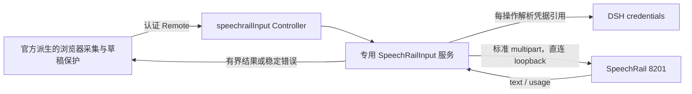

# 独立 SpeechRail DSH 语音输入 bundle 设计

- 版本：Draft 2，2026-10-23；尚未获得用户实施批准。
- 状态：Draft 2 已通过独立架构/安全审查与 Builder Checker 复核；等待用户批准，禁止自动实施。
- 审查记录：[审查与修订证据](../../reviews/2026-10-23-design-review.md)。
- 项目：`@hrygo/dsh-speechrail-bundle`（建议包名，不表示已经发布）。
- 官方基线：[来源清单](../../../upstream/baseline.json)，tag `dsh-v0.2.1-rc.2`，commit `687f282e8625c6b8d11ff58211a90524be2e4317`。
- 架构选项：[ADR-0001](../../decisions/0001-independent-speechrail-input.md)。

## 1. 用户目标与本轮交付

用户明确要求：以官方 bundle 为基础创建独立插件仓库，先建立官方基线，再设计重构和替代方案；方案审查通过后，经用户批准才实施。

本轮交付为本地 Git 仓库、不可变官方快照、方案、审查记录。没有产品运行源码、根安装入口或当前 profile 变更。未创建远程仓库，未推送。

“独立”定义为：自己的包名、Loader entry、设置页、服务、Remote namespace、locale 和浏览器偏好；只安装本包即可工作，不要求开启原官方 voice bundle。仍依赖 DSH 核心扩展服务，不复制整个 Harness。

## 2. 产品范围

### 目标

- 浏览器点击麦克风、明确授权、录音、停止后转写。
- SpeechRail 作为唯一后端；使用标准 OpenAI-compatible multipart 文件转写。
- 结果进入原会话草稿，不自动提交给 Agent。
- 保留官方设备选择、权限晚到清理、草稿 revision 冲突保护、取消与卸载资源释放行为。
- 在独立设置页显示本机连接状态、凭据是否配置、语言和非敏感参数。

### 非目标与反目标

- 不支持 Realtime/WS、流式字幕、TTS、分人、时间戳、唤醒词、常开麦克风或自动发送。
- 不提供任意 OpenAI 云后端、多 provider registry 或模型目录。
- **2026-10-24 修订（0.2.0）**：接受"同机回环上的其他 OpenAI 形状引擎"。这不是云端 fallback：地址仍限
  127.0.0.1/::1 与精确 `/v1`，只是不再要求响应携带 SpeechRail 的 `usage` 扩展、也不再把缺失的能力端点当作
  故障（见下方 107/141-147 的修订）。
- 不下载、加载、卸载模型；不管理 SpeechRail 服务、profile、worker 或版本。
- 不自动读取 SpeechRail 私有配置或复制密钥；不更改 DSH 全局 credentials provider。
- 不承诺 HTTP 取消立即停止后端；不把 readyz、状态检查成功或测试通过当成识别质量证明。
- 不与官方麦克风或其他 composer activity 强行抢同一席位，不自动关闭他人插件。

## 3. 推荐架构：专用薄切片 C



建议单一发布包，根仓库作最小 workspace，运行包位于 `packages/speechrail-input/`。这是为了容纳 Host/Client 编译面和官方公开 Typert generator 的 workspace 发现规则，不代表拆成多个发布产品。

运行链不依赖官方 `dsh-experimental-voice-input-bundle`、SenseVoice、sherpa 或原 STT/API 包。直接依赖 DSH 的核心 Cordis、Settings、Credentials、Storage、Tools、Typert/Remote 扩展点；Storage 仅保存非敏感未结案标记，不保存音频或密钥。

### 有限派生边界

| 官方来源 | 初版处理 | 必须保留或改变 |
|---|---|---|
| [audio.ts](../../../upstream/deepseek-harness/packages/experimental/client-ui-voice-input/src/client/audio.ts) | 有限派生 | 16k WAV、最后一块 flush、权限晚到、tracks 与 AudioContext 关闭 |
| [VoiceInput.tsx](../../../upstream/deepseek-harness/packages/experimental/client-ui-voice-input/src/client/VoiceInput.tsx) | 有限派生 | captureInsertion/insertText(span)、generation、冲突保留、onActiveChange 复位 |
| [设备组件](../../../upstream/deepseek-harness/packages/experimental/client-ui-voice-input/src/client/MicrophonePicker.tsx) | 简化重构 | 设备缺失不静默换输入；改为显式点击才开始电平预览 |
| [Waveform.tsx](../../../upstream/deepseek-harness/packages/experimental/client-ui-voice-input/src/client/Waveform.tsx) | 有限派生 | 动画取消与无障碍标签 |
| [wave.ts](../../../upstream/deepseek-harness/packages/experimental/speech-to-text/src/wave.ts) | 精确保留校验行为 | 严格 RIFF 长度、16k/mono/PCM16 与时长校验 |
| 原 registry、PreparationCard、SetupPrompt、下载器 | 不进入产品 | 移除与单一外部服务无关的多 provider / 安装准备状态 |
| 原 controller 与 Transcript | 不直接复用 | 新契约表达未知推理耗时与结构化错误 |
| UI primitives/client-store/CSS | 自有有限控件和 store | 不运行时 import Harness Client 内部包；使用 React 与 alias tokens |

“删除”仅指未来产品中不引入这些分支；只读上游快照保持不变。派生文件附上游路径和版权，不改官方来源元数据冒充新包。

### 为何不选 B

B 可独立组合原 STT Service/API 并 fork Client，但[官方 Transcript](../../../upstream/deepseek-harness/packages/experimental/speech-to-text/src/types.ts#L107-L124) 要求 measured inferenceSeconds:number；SpeechRail JSON 没有该值。[原 controller](../../../upstream/deepseek-harness/packages/experimental/api-speech-to-text/src/index.ts#L89-L109) 还把结构化异常压成普通 message。

将 HTTP 耗时塞进 inferenceSeconds 或加 side-channel 会保留错误语义与多余状态。C 的初始构建工作更多，但删去这些长期适配点。本结论是契约判断，不声称原 JSON 路径实测一定拒绝 null。

## 4. 身份、共存和配置所有权

- 包名：`@hrygo/dsh-speechrail-bundle`；建议初始版本 `0.1.0`。
- Host entry：`speechrail-input`；服务与 wire namespace：`speechrailInput`。
- Tool entry：`speechrail-input-tools`，指向本包 `./tools`；只包装同一 Host 方法。
- 设置页 keyed slot：本包全名；locale：`speechrail-input`；浏览器偏好键：`dsh.speechrail-input.microphone`。
- composer 使用现有 `conversation.input.activity` 单席位，不改 shell 或 DOM。
- 安装前显式检查官方 UI/其他 activity 互斥。本 Client 在 `slots.inject` 的声明生命周期回调中，经公开 `ctx.slots.spec/entries` 检查 single 声明与全部 raw occupants；有占用、API不可用或注册失败时仅拒绝/回滚自己的麦克风，设置页显示冲突，不改变其他 entry。无占用时同步按默认priority=0注册，不用priority shadow。
- 用 `ctx.slots.subscribe` 观察后续成功注册的foreign occupant，出现时撤回自己并取消采集；不自动重抢，需用户显式重新尝试。订阅是microtask-batched，不是原子租约；后到同priority插件可能先被框架拒绝，故不承诺任意安装顺序下自动仲裁或零冲突。`slots.inject` 本身只跟踪声明，不监视占用。公开委托方法见 [SlotRegistry](</Applications/DeepSeek Harness.app/Contents/Resources/app.asar/dsh/node_modules/@deepseek-ai/dsh-client-ui-renderer/lib/client.js#L1537-L1601>)。
- 独立 namespace 不是 UI 共存方案；首版官方/专用麦克风互斥。
- 不需要引入 service isolate；本包只有一个专用实例。若后续多实例，再单独设计。

持久化配置归本包 entry，通过 `ctx.settings.update` 和 revision 检查写入。读取时投影安全字段，禁把完整 credential source 路径返回网页或工具。

## 5. SpeechRail HTTP 契约

### 固定子集

```text
POST {baseUrl}/audio/transcriptions
file = recording.wav（完整 canonical 16k mono PCM16 WAV）
model = speechrail/qwen3-asr-1.7b
response_format = json
language = zh | en；auto 时省略
Authorization = Bearer <仅 Host 内存中解析>
```

由 FormData/HTTP 实现生成 multipart boundary，不手写 Content-Type。baseUrl 默认 `http://127.0.0.1:8201/v1`。

只允许 http 的数值 loopback：`127.0.0.1` 或 `::1`，显式合法端口，路径恰为 `/v1`（可规范化单个尾斜杠）；拒绝其他 hostname、userinfo、query、fragment、任意路径、跳转和远程地址。localhost 不做 DNS 特例。传输使用明确直连 dispatcher，不继承 HTTP proxy；不允许把本机 key 经代理或 redirect 发走。

初版 model 固定上述 canonical ID。语言候选为 `auto/zh/en`，但 `auto` 始终只表示省略 language；只有能力快照明确公布 supported 且 values 包含精确 hint 时才开放 zh/en。语言域 unknown 时只开放 auto；若已保存 zh/en 而后来不再有证据，拒绝开始并提示用户改选，绝不静默切换。当前源码语言枚举为 unknown，不阻断默认 auto 的文件转写。不镜像模型目录，也不透传 `zh-CN`。

成功响应必须验证 text:string；`usage` 为可选扩展（**2026-10-24 修订，0.2.0**：早先要求它存在，
  目的是"不以缺字段的其他服务响应冒充已验证 SpeechRail"；该保证已按用户要求有意放弃，换取同机其他引擎可用。
  `usage` 存在时必须合法，否则仍以 `malformed-response` 拒绝；`null` 与缺省同义）。**（2026-10-24 / 0.3.0 推翻：`usage` 无人读取，为一个未使用的可选字段丢弃服务真的产出的转写不划算，现改为忽略该字段、只看 `text`。见文首 0.3.0 记录。）**允许空字符串作为无识别正文；不 trim 或重写非空正文。audioSeconds 以已经验证的 WAV 帧数为准；不请求时间戳，不以缺字段的其他服务响应冒充已验证 SpeechRail。

### 插件自己的结果契约

```ts
interface TranscriptionResult {
  text: string;
  audioSeconds: number;
  requestSeconds: number;
  inferenceSeconds: number | null;
}
```

requestSeconds 用 Host monotonic clock 测量出站请求开始至响应正文校验完成，包含 HTTP、排队、冷启动与推理。当前 inferenceSeconds 恒为 null，表示标准响应没有提供；绝不填 0 假装测得，也不宣传 requestSeconds 为纯推理性能。UI 不必展示计时；诊断可显示“请求耗时”。

## 6. 配置、凭据与检查

| 字段 | 默认与约束 | 更改行为 |
|---|---|---|
| baseUrl | `http://127.0.0.1:8201/v1`；第5节的数值回环规则 | 无在途任务时保存，随后状态 unknown |
| language | `auto`；zh/en 仅在能力明确枚举时允许 | 下次录音生效；unknown 仅允许 auto |
| apiKeyRef | `SPEECHRAIL_API_KEY`；POSIX 标识符 | 下次操作重新 resolve；不缓存密钥 |
| requestTimeoutMs | 150000；1000..180000 | 覆盖凭据、preflight、上传、等待和body的绝对总预算；修改仅影响新请求 |
| checkTimeoutMs | 3000；1000..10000 | 单次只读探针上限 |
| maxAudioBytes | 固定 4194304 | 不提供可调放大入口 |
| maxDurationSeconds | 固定 120 | 同时遵守服务更严格限制 |
| maxResponseBytes | 固定 262144 | Content-Length 提前检查，并累计读取字节上限 |

读取现有 `ctx.credentials.resolve(credentialRef(apiKeyRef))`；每操作重新解析，缺失则 fail-closed。不会调用 set/unset、自动解析 SpeechRail 私有 .env、生成新 key 或写入普通 Settings。

**现有 DSH credentials-local 是受限权限的明文文件，不是 Keychain。** 复用既有引用与新增密钥保存不是一回事。若引用尚未配置，设置页只提示用户选择既有 DSH 凭据路径；任何新增落盘都要用户明确决定。本方案不实现新的密钥保存表单，也不更改 credentials provider。

### 检查状态

状态由专用 discriminated union 表达：`unknown/checking/ready/unavailable/auth-required/incompatible/conflict/busy/draining/outcome-unknown`，不挪用原模型准备阶段的 standby/unprepared。

首次启用只注册能力；不自动采集、调用推理或检查。用户点击“检查连接”触发认证 GET `{baseUrl}/speechrail/capabilities`，在一个 checkTimeoutMs 预算内完成。没有轮询、GET自动重试或 readyz fallback。

有效快照必须满足：schema_version 精确为 `effective_capabilities_v1`；`operations.transcription.status === 'supported'`；`operations.transcription.output.formats` 含 json；`operations.transcription.input.max_upload_bytes`、`.max_audio_seconds` 是有限正数。没有 `.available` 或 `.ready` 公开字段，不能猜字段。

读取 `operations.transcription.languages.status/values`。supported 时只开放 values 与 zh/en 的精确交集；unknown 时保留事实、开放全部已知语言并把用户选择作为**未验证提示**发送（**2026-10-24 修订，0.2.3**：原设计"unknown 只开放 auto"已被活的 SpeechRail 证据推翻——本机快照为 `transcription.status: supported` + `languages.status: unknown`，而其 `/v1/audio/transcriptions` 的 OpenAPI 明确接受 `language` 提示；不把语言域 unknown 偷换成整个 ASR 不可用）；`unsupported` 则只开放 auto，不臆造语言域。401 显示 auth-required；未知 schema/缺字段/非法限额显示 incompatible（**2026-10-24 修订，0.2.0**：能力端点答 404/405 时不再算
  失败，而是稳定的 `capabilities-absent`，服务按纯转写端点继续可用；501 仍按 5xx 处理）；supported 以外显示 unavailable。能力服务自身故障不能推断 ASR 模型已坏。

这些嵌套字段来自本机 SpeechRail 参考实现的 `capability_snapshot.py`（未随本仓库分发），OpenAPI 对 operations 为开放对象；因此必须有专用投影测试，不声称机器契约已完整枚举。

有效录音上限取 `min(4194304, max_upload_bytes)` 与 `min(120, max_audio_seconds, (有效字节上限-44)/32000)`，按完整PCM帧向下取整。不能容纳至少一个PCM帧则 unavailable。将两项有效上限随 status 发给 Client，计时器/编码截断与 Host 校验共用；服务限额更小不静默超限。

检查结果只表示当时路由可用性。（**2026-10-24 修订，0.2.5**：以下为原设计，已由实现有意取代——快照**不设过期时间**，`checkedAt` 只作展示，`check()` 仅由设置页按钮与 agent 工具触发，上传前不做能力重检。理由：每次听写都插入一轮网络往返，并可能在用户已经说完之后才新增一次拒绝；最后一次服务声明持续生效，若服务实际不同意则由它自己的错误回答暴露。原"缓存最长30秒""每次POST前重做能力检查"未实现，故不在此继续声称。）能力检查的结论仍受规范化端点、配置 revision 与凭据引用上下文约束；配置或已知凭据更新会重启条目并丢弃快照；不跨认证上下文复用任何结论。检查不能清除 draining/outcome-unknown，也不证明前一请求完成，不触发模型准备或服务管理。

## 7. 生命周期、取消和并发

### 录音与隐私

设置页默认只列设备，不申请麦克风。用户明确点击“测试麦克风”才采集电平；预览不录制、不上传，并在隐藏、离页、换设备、卸载时释放。录音开始前给出权限；许可晚于取消到达时立即 stop tracks。

停止后等待 MediaRecorder 最后一块，再解码并输出 16k WAV。采集数据仅在内存，转写后释放；不生成音频附件、不写 Session 事件、不记录音频/base64/正文。实际用户提交草稿才进入普通消息链。

捕获 span 与会话 generation；会话切换、取消、卸载后迟到结果不能插入。草稿 revision 变化时保留结果供显式插入/丢弃，不覆盖用户编辑，不自动发送。

### 一个本地在途任务

Host-wide、跨 tab/session 的 gate 在第一个 await 前同步 claim，覆盖检查、HTTP 请求、body 校验与清理。第二个转写立即返回 busy，不排队、不抢占。只保证本插件的本地在途数，不保证其他 SpeechRail 客户端或服务端总并发。

转写发出后用户取消：立即停止 UI 插入、释放麦克风，Host 保持原 POST 在有限总 deadline 内 drain；服务状态为 draining，新转写拒绝。正常响应或明确终态错误到达后丢弃结果并释放 gate。Remote caller 取消不应把同一音频重发。

硬超时、网络中断或卸载强制中止本地 transport：结束本地资源所有权，但远端完成情况为 outcome-unknown；禁止自动重试和后台重放。界面明确提示“服务可能仍在处理”。只读检查不能清除该状态；用户主动开始全新录音前须单独确认该风险，才建立新意图，不重用旧音频。确认不是后端已释放的证据。

### 跨卸载/重启的未结案标记

首次 POST 前，必须先把 `{operationId, phase:'pending', createdAt}` 持久化到本包自有、profile稳定命名的 journal；成功后才发送音频。只保存非敏感元数据，绝不保存音频、base64、正文、密钥或请求重放材料。写入失败则不POST。

使用已核实的 `ctx.storage.backend.get('json').kv.open(...)`，descriptor 采用本包稳定unit名、version=1、tables=[]、hasGlobal=true、layout='single'；当前 json backend 的每次成功写入为 durable。不要选把坏记录当不存在的 per-record 形式。Backend缺失、journal读写失败、格式未知/损坏均 fail-closed，不把异常当首次空记录；单profile仅支持一个DSH Host写入者，不声称具备跨进程锁。

新服务实例必须在接受 check/POST 之前读取journal。存在任何未结案ID则直接恢复 outcome-unknown，检查成功也不能清除。正常HTTP终态或用户 `acknowledgeUnknown` 才能按当前operationId比对后清除；所有写入由同一Host串行化，迟到的旧ID不得清除新记录。硬中断保留标记，卸载/重装不删除journal。清理写入失败也保留unknown。此处只处理有限操作元数据，不构建通用jobs/恢复框架，也不恢复音频重发。

卸载先关闭新准入，再 abort 并 join 本地任务、保留未结案标记、关闭 dispatcher/journal、退订状态与 Remote、释放 UI/样式/事件。不得强杀 SpeechRail 进程。服务端实时 ASR 互斥及队列策略仍由 SpeechRail Resource Governor 决定。

## 8. Host、Remote 与 agent 的共同边界

建议公开 Host 方法：`status()`、`check(signal)`、`configure(patch, expectedRevision)`、`transcribe(request, signal)`；Client-only 另有 `acknowledgeUnknown(operationId)`，只对当前未知操作ID有效、不重用旧音频，确认后回 unknown 等待新检查。它不暴露给agent工具，也不等于后端取消成功。状态订阅供 Client 所有者统一管理。业务校验与请求 gate 只实现一次。

Remote namespace 为 speechrailInput，携带生成元数据与有界输出。UI 只使用生成的 Remote contribution，不调用 Inspect 方法，不假设 @Remote 装饰器足以替代生成产物。

生成器默认normal codec可能先strip对象未知键；因此业务载荷通过有界JSON字符串carrier传入，Host先限长再JSON.parse并按严格schema校验，避免未知键在业务层之前被抹掉。配置payload上限8192字节，转写payload上限6291456字节（含base64及固定字段），同时保留原二进制4MiB校验。这里的“未知字段拒绝”针对插件业务payload，不承诺改变DSH Remote传输envelope策略。必须通过真实Remote入口的mock集成测试证明，而非只测直接Host调用。

薄工具建议名 `speechrail_input`，仅 `status/check/configure` 三个 action；返回小型安全状态和结构化失败。不接受音频、base64、密钥、任意路径或服务管理命令。与 UI 走相同 Host 方法；录音权限、未知结果风险确认与麦克风测试保留用户操作。工具没有“转写”动作，避免音频进入模型上下文。

配置 patch 只允许第6节可调字段；未知字段、错误类型、超限值、预期 revision 不符与在途时修改端点均拒绝。工具不安装、启停或写凭据；现有 plugin_manager 保留 bundle 管理职责。

错误投影仅允许 `code/httpStatus/retryable/requestId` 安全字段及本地化 message。稳定 code 至少覆盖 configuration-invalid、credential-missing、authentication-failed、service-unreachable、asr-unavailable、busy、invalid-audio、invalid-response、timeout、cancelled、remote-outcome-unknown、conflict。

不把 raw exception.message、上游 body、模型路径、URL、Authorization、转写正文回显到错误。requestId 限长与安全字符校验；retryable 仅为服务事实，不触发本插件自动重放。401/403 不重试；429 与 backend_busy 提示等待；5xx/网络故障不改识别器。

## 9. 独立构建、发布与验证门禁

建议 TypeScript + React，Node 24+，以当前 DSH 0.2.1-rc.2 核心契约为首个验证目标。核心包以 peer/runtime 复用，React 由 Host module table 提供，不重复打包。确切开发依赖版本在批准后的首个工具链任务中锁定；不得顺手升级现有 App。

Client 采用本地小型 tsdown 配置输出 `window.__ModuleLoader__.load({id,factory})`，ID 与包名一致；自己的控件/store/CSS 只依赖 React 和 `--dsw-alias-*` tokens。不导入上游 780 行 monorepo builder，也不依赖 App 内部源码路径或工作区外相对路径。

公开 [Typert generator](../../../upstream/deepseek-harness/packages/typert/generator/README.md#L67-L77) 提供 ./tsdown 与 artifact writers。2026-10-23 已只读查询 [npm 版本元数据](https://registry.npmjs.org/@deepseek-ai%2Fdsh-typert-generator/0.2.1-rc.2)：HTTP200，0.2.1-rc.2 实际导出 ./tsdown，Cordis peer 为 ~4.0.5；没有安装或执行该包。最小 workspace 含根 Host/Client tsconfig 聚合和 packages 目录；采用单运行包、严格生成 Host ./typert 和 Client ./remote 后再编译 Client。

**批准后第一门禁：** 验证最小 workspace 的生成、编译、pack 文件清单、Host strict codec、Client mount/withdraw。没有通过时停下报告，不扩大成复制整个 DSH 或放宽 source fallback。当前没有运行这些构建，也不承诺已跑通。

发布包包含运行产物、生成 descriptors、语言资源、原始/许可合规图标、许可证与必要文档；不含 upstream 快照、真实音频、密钥、测试缓存或开发依赖。首次变更 exports/包模块代际按 loader 缓存规则可能需要重启现有 Harness，不启动替代 Web server 来冒充生效。

## 10. 待批准后的文件职责与分段验证

以下是设计分解，不是已开始执行的实现计划；用户批准后再写逐任务 TDD 计划。

| 文件组（均待创建） | 唯一职责 | 最小证据 |
|---|---|---|
| `packages/speechrail-input/package.json`、patch、locale/icon | 独立发布身份与元数据 | pack 清单、版本门槛与资源检查 |
| `src/contracts.ts`、`src/host/controller.ts` | 结果/状态/错误与严格 Remote | 非法字段拒绝、artifact/mount/withdraw |
| `src/host/config.ts`、`credentials.ts` | 参数约束、每操作解析引用 | loopback/redirect/proxy边界、缺key、旋转、不set |
| `src/host/service.ts`、`client.ts`、`journal.ts` | 单在途、发现、HTTP、取消与非敏感未结案标记 | race、bounded-body、soft-drain、unknown、不重放；在途POST→卸载→重载→检查不解门禁，损坏journal fail-closed |
| `src/audio/wave.ts` | canonical WAV 校验 | 头部、长度、采样率、120s/4MiB边界 |
| `src/client/recording.ts`、设备/波形控件 | 官方派生采集资源 | 末块、拒权、晚到、设备拔出、显式预览 |
| `src/client/VoiceInput.tsx`、mount/settings/store | 草稿安全与独立UI生命周期 | span冲突、generation、单席位、theme/locale、卸载 |
| `src/tools/index.ts` | 同Host状态/检查/配置入口 | UI/tool一致、无音频/secret参数 |

自动化首先只用 fake fetch、合成内存 WAV、mock MediaRecorder 和测试 DOM，不调用本机模型或真实麦克风。旧测试只挑保留行为重建，不把 SenseVoice 下载/worker 测试搬入产品。

真实验收另批：安装/启用当前 profile、正确凭据接线、短中文及混合语言录音、窗口交互、忙态、HTTP abort 后服务端事实。真实 UI 自动化必须逐次授权。本方案获批不代表这些运行态动作默认获批。

## 11. 风险、替代与回退

- 构建风险：C 需要自有严格 Remote；先做工具链门禁，不把未验证的独立生成伪装为已支持。
- UI 接缝风险：single slot 的安全占用发现尚未验证；实现前要核实正式契约，不能静默覆盖。
- 凭据风险：默认 provider 明文持久化；本包不新增写入。用户若要求 Keychain，只能另设范围。
- 取消风险：HTTP 断连不能证明后端停算；软 drain 与 unknown 提示保留真实边界。
- 上游演进风险：DSH 核心未承诺跨实验版本兼容；首版锁 rc.2 验证，不臆造宽版本支持。
- 质量风险：服务在线不等于识别质量；真实录音与性能未验证。

回退只禁用/移除本包，保留用户配置与凭据，不删除模型或服务数据。无自动迁移原官方设置；浏览器设备偏好独立保存，用户自行重选。官方 bundle 原开关不由本包写入。

## 12. 审批与未验证项

用户可批准本设计、选择备选 B（须处理契约差异），或要求调整范围。默认推荐 C、loopback-only、停止后转写、无新增密钥持久化、显式麦克风预览、与官方麦克风互斥。

尚未批准实施；也没有产品测试/构建/真实端到端通过结论。此前 2026-10-23 13:09 的只读实测为 SpeechRail 4.3.0、quality/quality、capabilities 无凭据返回401；本文件不把该时点快照当成现在持续可用或鉴权已解决。

独立审查记录必须写明审查的设计版本、问题与复核结果。仅当审查无阻断项后，才把该版本提交用户批准；实施前记录用户明确回复，不自动进入下一阶段。

## 实施决策与偏差（2026-10-23，用户批准实施后）

经用户批准的实施方案为“独立薄切片”。以下为实现期确定的具体决定；除第一项外均为收窄或等价替换，未改变安全边界。

1. **新增私有类型垫片 `packages/typert-protocol`（经用户单独确认，A 方案）。** 实测约束：Typert 生成器只在 `<root>/packages` 下按 tsconfig references 识别包，且 `isTypeMetaSymbol()` 要求 `@Remote` / `TypertRemoteService` 的声明符号位于一个已注册且名为 `@deepseek-ai/dsh-typert-protocol` 的工作区包内。仓库外依赖 npm 版协议时生成器判定“有 Remote 导出但没有 Remote 方法”，无法产出 `lib/typert.host.js` 与 `lib/typert.remote-client.js`。垫片为 declaration-only、private、不发布；`tsconfig.base.json` 的 `paths` 只影响类型解析，`lib/index.js` 仍 `import '@deepseek-ai/dsh-typert-protocol'`（已核验），pnpm 不链接垫片。`tests/typert-protocol-parity.host.*` 用已发布声明验证同一装饰器与构造函数写法，并断言运行时导出存在。
2. **单一入口，暂不注册模型工具。** 设计 §8 允许“至多补一个薄操作入口”；`speechrail-input-tools` 未实现，Host 服务与 Remote 面即为全部入口，工具可在不改动线协议的前提下后续追加。
3. **暂不做麦克风设备选择器。** v1 使用系统默认输入设备；设备标签枚举需要先获得权限授予，属于可在不改变 Host 契约的情况下独立追加的客户端能力。
4. **客户端样式改为内联样式 + `--dsw-alias-*` 变量**，不引入 CSS Modules 管线；因此客户端 bundle 配置无需 `@tsdown/css`。
5. **`model` 默认留空**而非固定模型 id：SpeechRail 按 profile 校验模型 id（实测 `asr-1.7b-q8`），空值即省略字段交由服务端选择。
6. **音频时长不在客户端传递**，统一由 Host 从校验过的 WAV 字节推导；`SpeechRailTranscribeRequest` 仅含 `operationId` 与 `audioBase64`。
7. **构建拓扑**：`scripts/generate-typert.mjs --skip-diagnostics`（客户端面导入本包自身生成的 `./remote`，因此工件须先于类型检查存在；重复的诊断门禁由 `tsc -b` 与 tsdown 插件的生成遍承担，后者带诊断运行）→ `tsc -b` 双面 → host 与 client bundle。

## 已验证与未验证

已实测：Typert 生成产出 host 与 remote-client 工件（命名空间 `speechrailInput`、5 个端点、`payload: string` 载体保留）；`tsc -b` 双面零诊断；host 50.63 kB 与 client 89.42 kB bundle 产出，client 仅 `require` `react`、`react/jsx-runtime`、`zod`（与官方客户端 bundle 同形）；67 项测试通过；`npm pack` 51 个文件、无测试、无 sourcemap、无音频或凭据。

未验证：真实 SpeechRail 服务往返、真实麦克风采集、在 DSH profile 中的实际加载与渲染。以上均需另行授权，本轮以 mock 与静态证据为限。

## 独立审查修正（2026-10-23 第二轮）

一次独立只读审查提交了 10 项发现。逐项处置如下，均已实测（`pnpm verify` 全绿，98 项测试）。

1. **F1（阻断级）已修复。** `.volatile()` 字段被当普通值读取：schemastery 对 volatile 字段返回 `{ get() }` 句柄，`this.config.baseUrl.trim()` 在运行时抛 `TypeError`，而 tsc 与原有 67 项测试都无法发现（没有测试实例化服务）。修复：只有 `language` 与 `requestTimeoutMs` 保持 volatile，`baseUrl`/`model`/`credentialRef` 改为静态（与注释声明的安全意图一致）；新增唯一允许的读取器 `readConfig()`，类型改为 `Volatile<T>`，直接读普通值会编译失败。新增 `tests/config.host.spec.ts`（5 项）把真实 schema 的输出喂给该读取器。
2. **F2/F3 已修复。** 不可读 journal 会被永久卡住且两个 UI 的确认按钮静默返回。新增 `PendingJournal.reset()`：仅在门禁为 `unknown` 且无匹配 id 时，接受 `{ operationId: null }` 作为“用户确认没有未决上传”，写入仍失败则拒绝（`journal-unavailable`）。测试替身改为忠实模型（读失败必然清写失败），并补上“损坏记录可恢复”“介质不可写时拒绝重置”“写失败不留幻影记录”三项测试，替换原先断言 `gate === 'ready'` 的错误期望。
3. **F4 已补测。** 新增 `tests/http-transport.host.spec.ts`（12 项，真实 loopback HTTP 服务）：成功往返、省略可选字段、401 且不泄漏凭据、不跟随重定向（断言目标未收到请求）、响应字节上限、非转写响应、超时后 `outcome: 'unknown'`、取消后 `outcome: 'unknown'`、不可达、能力快照投影与三种探测结果。新增 `tests/remote-entry.host.spec.ts`（7 项）走生成产物的真实 Remote 入口：断言 5 个端点、只读端点无参数、写端点单一 strict string 载体、`signal` 取消参数、结果类型取自 `./types` 子路径，并把该载体字符串喂给 Host 解析器证明未知字段被拒绝。
4. **F6 已修复（第六轮补全）。** 探测失败不再清空能力缓存：`check()` 保留上一次快照，避免服务曾声明更小限额后一次瞬时不可达就把强制限额放宽到绝对上限。第六轮进一步发现：可识别但未声明输入限额的 200 仍会按字段回落到绝对上限，故改为「快照未声明的限额继承当前生效值」（见第六轮）。
5. **F7 已修复。** multipart 字段名与值在写入前剥离 `"`、CR、LF，注入新 part 或新 header 不再可能；新增两项注入测试（字段值、文件名）。
6. **F9 已修复。** 跨 Remote 的 `baseUrl` 只取规范化结果，操作者键入的 userinfo 不再回显到网页。
7. **F5/F10 部分修正。** 响应上限从 1 MiB 改回设计规定的 262144；删除无引用的 `CAPABILITY_TTL_MS` 与 `CANCEL_DRAIN_MS`；`usage.seconds` 要求非负；等价性测试的运行时断言不再自证，改为编译期单向可赋值证明（已发布 → 垫片；反向刻意不要求，因为垫片把错误侧放宽为普通接口，而本包只读 `error.message`）。
8. **F5 剩余项按偏差记录（不改实现）。** `checkTimeoutMs` 未做成可配置，固定为 5000；状态机为三态而非设计中的判别联合（`draining` 未实现，因为上传体没有可取消的排空阶段）；能力快照按“机会式”使用而非严格校验 `schema_version`/`output.formats`/限额齐全——严格校验会在无法实测真实服务的情况下引入误拒，而限额只会收窄（第六轮起严格为「未声明即继承」，见第六轮），故取此偏差。
9. **F8 部分修正。** 代理声明降级为“宿主未以 `NODE_USE_ENV_PROXY`/`--use-env-proxy` 启动时成立”，并在 `src/host/http.ts` 顶部注明残余依赖；不新增显式 agent 选项以免影响本机常规配置。
10. **未验证项澄清。** 客户端面只有字典测试（`locales.client.spec.ts`）为自动化覆盖；设计中原计划的 jsdom 组件测试与 mount/withdraw 测试未实现，实施计划中的“客户端已完成并验证”据此更正为“构建与类型检查通过、字典有测试、组件无自动化测试”。**（第四轮已追加 `voice-input.client.spec.tsx`；mount/withdraw 仍无自动化测试。）**

## 第三轮：薄 agent 工具（2026-10-24）

本节取代上文「实施决策与偏差」第 2 项（当时记录为“未实现，留待后续”）。

**已实现 `speechrail_input_status`**：唯一的模型可见入口，只读。它报告：生效的 loopback 端点、端点是否被接受、凭据引用是否解析出值、服务是否应答且接受该凭据（仅在 `probe: true` 时发起一次本地请求）、当前语言与上传限额、门禁状态与待确认的 operation id。它不上传音频、不写 journal、不改变门禁，且规范化值中只有布尔与短字符串——凭据本身与转写文本都无法出现。

**注册方式**：`apply()` 内 `ctx.inject(['tools'], …)`，仅在 Harness 提供 tools 服务时注册，并通过 `ctx.effect` 绑定释放；缺少该服务时插件其余功能照常工作，因此不引入新的硬依赖（`dsh-tools` 既不在 `dependencies` 也不在 `peerDependencies`）。

**为什么定义是结构化的而不是 import `defineTool`**：一旦从 `@deepseek-ai/dsh-tools` 引入声明，其类型会牵入 `@deepseek-ai/dsh-llm`，该包的 `TypertLookupMap` 声明在 Typert 分析过程中被判为“必须是 TypertLookup<Host, Wire>”，导致生成整体失败（与本包无关的第三方声明触发分析器限制）。因此本包自行声明注册表所消费的最小结构（`name`/`description`/`parameters`/`output.schema`/`output.render`/`execute`），其编译后形状照 `defineTool` 的实际输出逐字核对（`parameters` 为隐式开放对象根 `{type:'object',properties}`，输出模式为 `{type:'object',additionalProperties:false,properties,required}`）。注册表仍在执行期按这些 JSON Schema 校验参数与结果，因此校验强度不变。

**测试**：`tests/tools.host.spec.ts` 6 项——参数与输出模式形状、默认不联网、`probe: true` 才联网并反映探测结果、端点被拒/凭据缺失/门禁阻塞映射为数据、渲染单行摘要、不可达与未探测的文案区分。**未验证**：在真实 profile 中的注册与调用（本轮不激活任何 profile）。

## 第四轮：客户端组件测试与一处可达性缺陷（2026-10-24）

新增 `tests/voice-input.client.spec.tsx`（jsdom + Testing Library，3 项），覆盖 composer 控件的确认路径：带 id 的确认、`operationId: null` 的确认（F2 修复的 UI 侧）、门禁正常时不出现确认控件。

该测试暴露出一处此前未被任何测试覆盖的真实缺陷：确认按钮原本只在控件展开（`phase !== 'idle'`）时渲染，而重载后门禁已阻塞时控件处于收起态——用户点击麦克风只会看到“门禁被占用”的消息，却拿不到清除它的按钮（只有设置页能清）。修复：门禁为 `unknown` 时，收起态也渲染确认按钮。此项同时取代第二轮记录中“两个 UI 的确认按钮静默返回”的处置结论：静默返回已修好，且按钮现在在两种状态下都可达。

### 清单修正：`dsh.client.inject` 只列客户端插件（2026-10-24）

对照官方客户端插件清单（`dsh-client-ui-conversation`、`dsh-client-ui-plugin-manager`）核对后修正：`inject` 的语义是“本插件等待哪些**客户端插件**的服务”，而 `@deepseek-ai/dsh-client-ui-slots` 既无 `dsh.client` 也无 `./client` 导出，是纯类型/工具库，列出它属于错误声明；真正提供 `ctx.slots` 服务的是客户端插件 `@deepseek-ai/dsh-client-ui-renderer`，已改为列出后者。最终列表：`dsh-api-remotes`（`ctx.remote`）、`dsh-client-locale`（`ctx.locale`）、`dsh-client-ui-conversation`（槽位属主）、`dsh-client-ui-renderer`（`ctx.slots`）。客户端 bundle 的运行时 `require` 仍是 `react`、`react/jsx-runtime`、`zod`，与官方客户端 bundle 同形。

## 第五轮：对第三轮核验发现的处置（2026-10-24）

第二次独立核验（对抗性）在修复后的提交上又发现 6 项问题，其中一项使 agent 工具**完全无法注册**。逐项处置：

- **H1（高，工具形同不存在）** `OUTPUT_SCHEMA` 在每个属性上写了 `required: true`。注册表的 `assertSupportedJsonSchema`（dsh-tools `lib/index.js` 的 `register()` 调用）只在对象节点上接受 `required`，因此注册抛错、工具从未生效；而 `defineTool` 的编译产物把必需性放在顶层 `required` 数组、属性上不留该键。已改为该形状，并用**真实断言**验证：修复后的 schema 被接受，改回旧形状则被拒（`schema.properties.endpoint.required is not supported on type "string"`）。新增 `tools/check-tool-schema.mjs` 把这个检查固化：它需要临时安装 `@deepseek-ai/dsh-tools`（该依赖会破坏 Typert 生成，因此不能常驻），脚本头部写明了安装/运行/卸载三步，也支持直接指向任意一份包副本（含 pnpm store 里残留的）。实测输出 `check-tool-schema: speechrail_input_status is accepted by the registry assertion (12 output fields)`，退出码 0；包不存在时给出明确提示并退出 2。单元测试同时断言该不变式（属性上无 `required`、顶层 `required` 覆盖全部属性、`additionalProperties: false`）。
- **同时修正一处错误陈述**：注册表**不会**在执行期重新校验参数——原样注册绕过参数校验。工具因此把「非 `true` 即不探测」作为唯一入口条件，并在 `execute` 里对 `args` 做空值防护。
- **H2（中，会抹掉真实的未决记录）** `{operationId: null}` 原先只看门禁状态，不看 `pendingOperationId`，于是在记录**可读**时也能把一次真实未决上传清掉，违反 `journal.ts` 与 `types.ts` 的契约。已改为：只要本机持有具体 id，就要求匹配该 id，否则返回 `conflict`；`null` 仅用于「记录不可读」的恢复。新增测试断言 `null` 在持有 id 时被拒、且随后用具体 id 可以正常清除。
- **H3（中，成功的探测仍会放宽限额）** 探测返回 200 但响应体不可识别时，原先把快照置空，限额回落到绝对上限（实测 1 MiB/30 s → 4 MiB/120 s）。已改为：只有识别出快照才替换，200 但不可识别时保留上次快照，并把该快照用于本次 check 结果。新增测试覆盖「可识别→不可识别 200→不可达」三种情况下限额不变。
- **H4（低，测试替身不忠实）** 真实 `journalFromUnit.reset()` 只写不读，读失败不影响它；替身此前把 `readFails` 当作重置失败，导致真正的写失败分支没被测到。已按真实语义修正替身，并把「介质不可写时拒绝 null 确认」改为同时设置读失败（构造 `null` id 的恢复场景）与写失败。
- **H5（低，常量未真正删除）** `CAPABILITY_TTL_MS` 与 `CANCEL_DRAIN_MS` 上一轮声称删除但实际仍在（当时的校验打印被我误读）。现已确认删除；快照不过期这一取舍记入 README（宁可偏紧，刷新靠下一次成功探测）。
- **H6（低，测试依赖被忽略的生成产物）** `remote-entry.host.spec.ts` 导入 `lib/typert.remote-client.js`，而 `lib/` 被 gitignore，干净检出下单独跑 `pnpm test` 会失败。根部 `test`/`test:host`/`test:client` 脚本已改为先执行 `gen:typert`，使测试可独立复现。
- **文档准确性**：README 中「未注册任何模型工具」的过期表述已改正；「限额只收窄」改为「只在明确识别到快照时变化，不可达或不可识别时保留上次限额」；`endpoint.ts` 中「describeRefusal 从不发给客户端」的注释与实际（作为 `endpointProblem` 发送）不符，已改写。

仍未解决且已记录：`remote-entry.host.spec.ts` 走的是生成产物的**元数据**与 Host 解析器，而不是真实的 Remote 派发（编解码、错误信封、`requestId` 提取、能力探测的 5xx/404 映射仍未覆盖）；客户端 mount/withdraw 仍无自动化测试。

## 第六轮：对第三轮核验剩余项的处置（2026-10-24）

第三轮核验确认第五轮修复有效，但指出两处仍未闭合的路径，以及若干一致性与文档问题。

- **H3 残余（中，可识别快照仍会放宽限额）** 只修「不可识别 200」不够：形如 `{"operations":{"transcription":{}}}` 的响应体是**可识别**的，但按字段回落到绝对上限，于是 1 MiB/30 s 仍会变成 4 MiB/120 s。已把规则改为「快照未声明的限额继承当前生效值」：`clampLimits(advertised, previous)`，`projectCapabilities(snapshot, previous)`，探测选项新增 `previousLimits`，`check()` 传入当前缓存的限额。快照**明确声明**的限额仍然生效（并在绝对上限内截断），所以服务依旧是自身限额的权威。新增端到端测试走真实回环服务与真实 `probeCapabilities`：紧限额 → 可识别但无限额的 200 → 限额保持 → 明确声明更小限额 → 限额跟随收紧；另有 `clampLimits` 继承语义的单元断言。
- **H2 残余（中，瞬时读失败后仍可盲清）** 若 `restore()` 时读失败，门禁为 unknown 且本机没有 id，客户端此时发送的正是 `null`；而 `reset()` 只写不读，于是「下次就能读到」的真实记录会被清除。已改为：`null` 分支在 `reset()` 之前**重新读一次**日志，若读到了记录就以 `conflict` 拒绝并采纳该 id。客户端配合修正：确认被拒后先刷新状态再提示，因此第二次点击会带上刚发现的具体 id，而不是继续发陈旧的 `null`（`VoiceInput` 与设置页都改）。新增 Host 测试（读失败 → 门禁 unknown/无 id → 读恢复 → `null` 被拒且采纳 id → 具体 id 清除成功）与客户端测试（拒绝后重新读取状态、第二次点击携带新 id）。
- **一致性** `check()` 在端点被拒分支原先返回 `capabilities: null`，而 `status()`/`run()` 仍在用缓存，前后不一致；现改为返回缓存，与实际强制值一致。
- **文档与注释准确性** `tools.ts` 模块头曾称「注册表在执行期校验参数与结果」——结果确实校验，参数不校验（原样注册绕过 `defineTool` 的参数校验），已改正；README 的「垃圾能力响应绝不会放宽限额」按新规则重写；`DEFAULT_LIMITS` 的注释改为「包自身上限，而非保守值」。
- **核验脚本增强** `tools/check-tool-schema.mjs` 现在同时做两件事：把 `createStatusTool(...)` 的 `parameters` 与 `output.schema` 与 `defineTool` 用等价 spec 编译出的 JSON 做结构比较，并调用注册表真实的 `assertSupportedJsonSchema`。实测输出 `speechrail_input_status is accepted by the registry assertion (12 output fields)`，退出 0。这使 H1 的真实要求（形状必须与注册表一致）自动化可复现，而不是一次性人工核对；脚本头部的路径提示也修正为「指向包目录本身」。

## 第七轮：对第四轮核验新发现项的处置（2026-10-24）

第四轮核验确认第六轮两处修复成立（40 条断言，无可用反例：任何响应序列都无法让运行路径强制一个服务从未明确声明的限额，任何读写失败序列都无法抹掉确认时仍可读的记录），同时提出三项新问题。

- **N1（中，并发 check 丢更新）** 并发调用 `check()` 时「后返回者胜出」：更早开始、携带旧快照的探测若更晚返回，会覆盖更新（更紧）的声明，并连带恢复整份旧快照。已改为**单飞**：同一时刻只允许一次探测，后来者直接复用进行中的 Promise，因此所有调用者看到同一份已提交结果；探测结束后下一次调用重新探测。新增测试断言并发两次只产生一次探测、两者结果相同，且结束后可再次探测。
- **N2（低，两处防御缺口）** (a) `projectLanguages` 原先只看 `languages.status`，于是服务声明 `transcription.status: 'unsupported'` 时仍会放开语言选择器；现改为仅在 `transcription.status === 'supported'` 时采纳语言。(b) `run()` 原先不看 `transcriptionSupported`，服务已声明不支持转写时仍会先上传；现于上传前以新增稳定错误码 `unsupported` 拒绝（错误码表、类型联合、中英文本均已补齐），且不占用门禁——因为并未发出请求。若快照为 `null`（未声明），则不视为拒绝。该链路已有端到端测试：真实回环服务返回 `status: 'unsupported'` 的 200 → 投影得到 `transcriptionSupported: false` 且语言为空 → 运行路径据此在上传前拒绝。
- **N3（信息，API 层幂等）** 门禁非 `unknown` 时确认请求返回成功且不改动任何状态，属幂等空操作；该组合在已发布的 UI 中不可达（确认按钮仅在门禁 `unknown` 时渲染，而 `unknown` 不会转为 `busy`），已加注释说明而非改行为。
- **刻意保留的取舍（核验者亦列为 by design）** 若确认时的重读**再次**失败（连续两次读失败）或记录同版本但结构损坏，`null` 确认仍会执行 reset 并清除记录。这是「介质不可读」时唯一的人工逃生口：按钮文案本身就是「我已向服务确认未完成」这一断言，日志接口文档也把 reset 限定为该场景。改成「读失败即拒绝」会在本地存储故障期间永久锁死门禁，代价高于收益，故保留；版本不匹配时存储单元打开失败、reset 返回 false，行为仍是 fail-closed。

- **给"发布"本身加守卫（此前无人审查过的面）。** 发布是手工三步：bump 版本、把三处 README 的安装 URL 指向新 tag、打 tag 并附上 tarball——三处必须一致，而流水线里没有任何东西会发现漏改：`v0.6.0` 的 tag 完全可能挂着 `package.json` 仍写 0.5.0 的包，README 也可能指向从未上传的资产，两者都要等安装后读版本才暴露。新增 `tools/check-release-consistency.mjs`：扫描 `packages/*/package.json` 中声明了 `dsh` 的包（版本须为 `x.y.z`、彼此一致），抽取所有 `releases/download/vX.Y.Z/` 安装 URL 并要求与版本一致；带 tag 参数（或 `GITHUB_REF_NAME`）时再要求 tag 命名该版本，非版本 tag（如 `latest`）按设计跳过。已接入 `pnpm verify`（`check:release`），并实测三种漂移全部被拒（只 bump 版本、tag 不符、README 单改），报错精确到文件。今后每轮发布都先跑 `node tools/check-release-consistency.mjs vX.Y.Z` 再打 tag。

## 2026-10-24 决定记录（0.6.0：刷新之后也说得出原因；把"未测"变成"已量"）

- **客户端接上宿主已经过界的原因。** 页面刷新会丢掉组件自己对那次尝试的记忆，所以门关着时它只能说"存在一次未确认的转写"；而宿主仍保留 `unprovenFailure`（0.5.0 加入、本就在边界 schema 里、无新契约）。现在**确认行与设置页门禁行**在门关着且（确认行还要求）没有其它消息时拼上失败细节（`gateUnknown` + `failure.server-error (req_1)`），宿主没有原因可给时**不编造**、只说门关着。
- **把审查者列的"未测"变成"已量"，再决定动不动它。** 近上限载体（6,291,446 字节）解析实测：`Buffer.byteLength` 单趟 **0.18 ms**、`JSON.parse` **2.47 ms**、整条 `parseTranscribeRequest` **24.86 ms**（其余为 base64 扫描）。故"重复一遍字节长度"只占 0.7%，**不改**。
- **刻意取舍：不用"解码后长度差"替代扫描。** 原生 `Buffer.from(text,'base64')` 约 0.5–0.8 ms，加长度比对可省掉约 22 ms 的 JS 扫描；但那会改变可证明的语义——`'===='` 这类无数据载体在长度规则下会被"接受"（随后才落到 `audio-invalid`），"载体畸形"（`bad-request`）与"音频不可用"的区分被抹平。当前扫描已两轮用穷举+模糊测试证明与最初正则等价，近上限一次约 22 ms 可接受，保持**可证明的规则**而非更快的启发式。
- **过程教训：变异必须真正命中被测代码。** 验证客户端文案时第一次变异改的是 `gateCause`（只用于 `title` 属性），套件仍全绿；那不是"测试没牙"，而是变异打偏了——命中两处后立刻失败。

## 2026-10-24 决定记录（0.5.0 续：v0.4.0 审查的三项发现）

- **HIGH（我自己上一轮引入的真缺陷）：未受信的"声明码"能逃出封闭词表。** `DECLARED_CODES[declaredCode]` 是对对象字面量的**原型链查询**，而 `readErrorEnvelope` 的过滤 `/^[a-z0-9_]{1,64}$/` 恰好放行两个继承名：`constructor` 与 `__proto__`。审查实测：`failureForStatus(422, 'constructor')` 返回的 `code` 是一个**函数**，`'__proto__'` 返回一个原型对象；`JSON.stringify` 会把它们丢掉（`code` 消失），而生成的 Remote 结果编解码器会**拒绝**这个值（`invalid_union`）——于是一次普通拒绝变成页面上的"内部插件错误"。改为 `Object.hasOwn(DECLARED_CODES, declaredCode)` 守卫，并补测试：四个继承名逐一断言 `typeof code === 'string'`、落到 `bad-request`、且 `JSON.parse(JSON.stringify(...))` 仍成立。
- **MEDIUM：`/chunked/` 子串匹配让"未分帧"的回复冒充分帧。** `notchunked`、`xchunked`、`chunked-fake` 都含 `chunked`，Node 并不会去分块，正文仍以 close 结束；子串判断会把一次未证明的结局**结算**掉（开门）。改为取 `Transfer-Encoding` 的**最后一个编码**并要求它恰为 `chunked`（`gzip, chunked` 因此仍然分帧，测试里用真实的分块终止符验证）。
- **LOW-MEDIUM：声明码凌驾于所有状态。** 实测的映射只在 422 上观察到，但原先任何状态都会被它覆盖：`401 + audio_decode_failed` 被报成"录音有问题"而不是"凭据被拒"。现在声明码**只在 `DECLARED_CODE_STATUS = 422` 上生效**，其余状态（401/403/404/408/3xx/5xx/200）照旧由状态决定；结算始终只由 `provesNotProcessed` 决定，不受影响。
- **两处"通过理由不对"的测试（审查指出，均已改正）**：`core.host.spec.ts` 的 base64 边界表里 `''` 是被解析器自己的空值检查拒掉的、早于扫描，故从表中移出单独断言（不再冒充字母表规则的证据）；`voice-input.client.spec.tsx` 原"从未上线"用例其实上传已在线（它在等被挂起的 `transcribe`），只证明了"门开着时保持安静"——真正的场景是**编码阶段取消**（`capture.stop()` 挂起、`transcribe` 根本不会被调用），已按此重写并断言上传从未发生。

## 2026-10-24 决定记录（0.5.0：关着的门要说得出为什么）

- **agent 侧缺口（客户端已经会说、工具却说不出）。** 门因"未证明"关闭时，客户端会连同失败细节一起告知（0.3.0 修的那处），而 `speechrail_input_status` 只能报 `gate unknown; awaiting acknowledgement of op_x`——**动作有了、原因没有**。journal 按设计只存不敏感的 operation id，所以原因无处可读：宿主在内存里保留 **`SpeechRailInputStatus.unprovenFailure`**（留下未证明结局的那次失败），工具以两个平铺字段（`unprovenFailureCode` / `unprovenFailureHttpStatus`）过界，仅在门关着时渲染成 "that attempt failed with server-error (HTTP 502)"，没有响应到达时则说 "before a response arrived"，不编造状态码。
- **开发中自查纠正的语义陷阱（值得留痕）**：初版记的是"最近一次失败"，于是门因 502 关闭后，**下一次被门挡住的尝试会把原因覆盖成它的后果**（`unknown-outcome`），本机拒绝也会覆盖它；而且成功清空后上报值仍可能残留。最终语义：记录点放在**认领之后**、只认未证明结局；上报值**由门状态派生**（开门即不报），所以状态永不自相矛盾；变异的检验点是"把记录挪到认领之前必须失败"。内存态：宿主重启会忘记原因，而它描述的 journal 记录仍在——取舍写在类型注释里。
- 新增 `unprovenFailure` 是**加性契约变化**（状态 +1 字段、工具 +2 字段），故记 0.5.0；边界 schema 由 Typert 构建期生成，`pnpm verify` 会重新生成（只跑单测会看到旧的 16 字段，这是我这轮踩到的坑）。
- **核查为正确、无需改动**：客户端副作用清理（`VoiceInput` 三个监听器全部 `removeEventListener`、定时器全部 `clearTimeout`；`Waveform` 的 `setInterval` 有 `clearInterval`；`Settings` 仅挂载时读一次）；插件生命周期（工具经 `ctx.effect(() => registry.register(...))` 注册，随作用域回收；`inject` 把 settings/storage/Remote 保持可选，缺基础设施时仍能加载并说明不能录音）；`protocol/wave.ts` 的格式检查是**精确等值**（采样率/位深/声道/byteRate 全等），因此不存在"0 采样率 → NaN 秒数绕过时长上限"的通道，长度一致性（RIFF 大小、data 大小、偶数样本）也都严格。
- **刻意取舍：录音到上限时的静默截断。** `Recording.stop()` 用 `Math.min(decoded.duration, maxDurationSeconds)` 截断到上限；正常情况下走不到这一步，因为客户端在 `maxAudioSeconds * 1000` 处**自动停止**录音、切到后台则直接取消，所以截断只会吃掉定时器抖动的那几毫秒（音频已在上限之内）。不为它新增提示界面：一是不改用户文本、二是不为"上限就是上限"这种必然结果造新表面，代价与收益不成比例。若将来把上限调高到用户容易说满的长度，再补一个成功后的提示。

## 2026-10-24 决定记录（0.4.0：向真实服务量，而不是推断；对账；声明版本全部实测）

- **拿真实服务量。** 对 `/v1/audio/transcriptions` 做了三次**零推理**探测（错误凭据 + 1 字节正文、正确凭据 + 非音频正文、读它的 OpenAPI），得到可复核的事实：OpenAPI 声明该端点响应集为 **400/401/413/422/429/502/503**；错误凭据得到 `401` + `{"error":{"code":"invalid_api_key","request_id":"req_…","retryable":false}}`（鉴权先于任何音频处理）；非音频正文得到 **`422` + `code:"audio_decode_failed"`**（`retryable:false`）。
- **由此修两处误报。** 422 的 `audio_decode_failed` 原先按状态落进 `bad-request`，文案让用户"检查配置"，而问题在录音本身；现在有一张**只收录实测或文档确认的声明码表**（未识别的码不改变任何判定），该码映射到 `audio-invalid`。**429** 原先同样被读作不可重试的 `bad-request`，而端点的语义是限流；新增 `rate-limited`（可重试）及中英文案。`413` 经核对仍是音频拒绝，保持不变。
- **结算规则被真实服务反向印证。** 它声明为拒绝的 400/401/413/422/429 正是"已证明未处理"，而 502/503 是后端故障、不构成证明——与 `provesNotProcessed` 一致。上一轮审查把这条记为"由 RFC 语义论证、未实测"，现在有该端点自己的响应集与两条真实响应作证据。
- **三态鉴权在真实服务上成立**（临时探针，用后即删，结论记于此）：正确钥匙 `accepted`；错误钥匙 `reachable:true / refused`（code `unauthorized`）；端口无人 `reachable:false / unverified`。这补上了"三态只对 stub 验证过"的缺口。
- **取消上传后的对账（客户端缺陷）。** 转写中按取消时，上传可能已经在线上：宿主把中止发给服务、无法证明服务对音频做了什么，于是保留为未证明并锁门。而客户端 `cancel()` 直接回 idle、不读门状态，用户会**完整录下一条**才被拒。现在取消会等这次调用落地并读门：门未证明就连同 `failure.cancelled` 细节一并告知（确认按钮在 feedback 阶段照常可用），若取消根本没到线上（编码阶段，或宿主已结算）则什么都不说。两个方向都有测试；去掉对账实现即失败。
- **审查（对 v0.3.0）九项，逐条处置。** MEDIUM：`audio-too-large` 在 4 MiB/120 s 上限下对规范 32 kHz 单声道录音不可达，而真正发不出去的**载体超限**（约 147 s 以上）反而报 `bad-request`——正是 0.3.0 想消灭的误报；现在载体超限在解析处就如实返回 `audio-too-large`，不再进入"检查配置"。
- 分帧判定原先只看"有没有 `Transfer-Encoding` 头"，于是 `identity`/`gzip` 这种**不分帧**的回复会被当成已答完并结算；现改为"有 `Content-Length` 或 TE 含 `chunked`"，并按审查建议**不使用** `response.complete`（那会把刻意保守的 close-delimited 情形也结算掉）。
- `413` 改为 `audio-too-large`（尺寸问题），`415` 仍是 `audio-invalid`（格式问题），消除"服务说太大、本地说格式不对"的不对称。
- 性能：逐字符正则（实测 61 ms/次）改为字符码比较（**20.8 ms**，含 JSON 解析），并去掉 `decodeBase64Audio` 的重复扫描——近上限录音的解析从约 132 ms 降到约 21 ms，且不再占用两倍事件循环。
- 测试缺口（审查以变异证明此前全绿）：`framed` 的 `Content-Length` 分支、base64 的 `% 4` 与字母表规则、413 的尺寸语义、`isBase64` 的空串差异，均已有具名测试；本轮的 6 项修复各自做了变异检验（回退即失败）。
- **刻意取舍**：`parseTranscribeRequest` 外的 try/catch 是无可测接缝的防御（旧的爆栈来源已被线性扫描移除，审查确认删除它不会有测试失败）——保留，因为它保证未来任何解析异常都落在封闭错误词表内，而不是变成页面无法本地化的 Remote 级错误。
- **声明支持的 Node 版本全部实测**：Node **22.23.4**（官方 tarball，SHA256 与发布页一致）与 **24.22.1**（同法校验）各跑完整套件，**16 文件 / 226 测试全绿、退出码 0**；Node 26 为本机日常运行时。此前多轮审查一直把"只测过 26"列为未验证项；远端 MegaCube 因沙箱失去网络与 `listen()` 权限无法完成（已如实记录，未伪造通过），改在本机用户态临时运行时完成，用后删除。
- **工作区 node 范围与发布包对齐**：根 `engines.node` 原为 `>=22`，与包声明的 `^22.19.0 || >=24.0.0` 不一致，已统一。
- 顺带核查（无需改动）：客户端 base64 编码按 8 KiB 分片，长录音不会爆栈；源码未使用任何 Node 24 专有 API；超限与失败后"重录"按钮无条件可用，不会出现"被告知却无法恢复"。

## 2026-10-24 决定记录（0.3.0：可构造的分支要测，不该丢的转写不丢）

- **推翻自己上一轮的记录。** 0.2.9 记录声称"该分支在回环上测不出来"。审查者给出了可构造条件（服务刷出 401 头后立刻断连，而客户端仍在写 ≥1 MB 请求体），我按此复现：0.2.8 顺序报 `unreachable`（而探针同一服务报 `refused`，两面对不上），0.2.9 顺序两面都是 `unauthorized`。注：断连必须是**优雅 FIN**；`destroy()` 的 RST 会在客户端解析到头之前丢弃它，那样构造出的就不是这个场景。已修正 `http.ts` 注释与 0.2.9 记录，并把场景钉进 `http-transport.host.spec.ts`（变异回 0.2.8 顺序即失败）。
- **200 但正文不可用：只有分帧才证明"服务已答完"。** 没有 `Content-Length`/chunked 时正文以 FIN 结束，"被截断"与"已完成"无法区分，此时保持未证明（`unknownFailure`）；有分帧（Node http、FastAPI 都会带）才按失败结算。`HttpSuccess.framed` 承载这个事实。
- **再次推翻旧决定：malformed `usage` 不再拒绝整条响应。** 该字段没有任何消费者，为一个不读的可选字段丢掉服务真实产出的转写、让用户重录，是拿用户的录音去成全一条原则。现在只看 `text`；`usage` 合法与否不影响可用性。旧记录行已就地标注推翻。
- **超限不再伪装成"格式不对"。** 线上实测服务声明 **512 MiB / 3600 s**，而本包刻意收紧到 **4 MiB / 120 s**（整段 WAV 要编码成 base64 放进一个 6 MiB JSON 载体，浏览器内一次性编码），这是记录在案的取舍；但原先超限与格式错误共用一个 `audio-invalid`，用户录了 3 分钟只看到"录音格式不被接受"。新增 `audio-too-long` / `audio-too-large` 两个码（码表 `Record<SpeechRailFailureCode, true>` 会在漏加时报编译错误），文案点明默认上限与"以能力快照为准"。
- **一条真实崩溃（审查与我各自独立发现）。** `BASE64` 正则 `/^(?:[A-Za-z0-9+/]{4})*(?:…)?$/` 在 V8 上对约 5 MB 输入爆栈（4 MiB 尚可），而载体上限恰好允许这种输入：录 121 秒就会让 `core.transcribe` 抛 `RangeError`，客户端只能显示"内部错误"。改为**线性扫描**（`decodeBase64Audio` 的第二处使用同源同治），并在公开入口加兜底 try/catch，使任何解析异常都落在封闭错误词表内。
- 删掉 `refuse()` 的死参数 `unproven`：所有调用点都传 false，而它一旦被传 true 就会制造"journal 已结算但消息说未证明"的分裂——正是 0.2.8 花力气消除的那种不一致。
- 补测试缺口（审查指出）：`provesNotProcessed` 真值表；答案阶梯现在同时断言 `code` 与 `httpStatus`（此前窄化 2xx 判断仍能全绿）；客户端"未证明"文案此前完全没有测试，现已覆盖（500/202/纯超时三种细节）。

## 2026-10-24 决定记录（0.2.9：到达的拒绝优先于传输码）

- 审查留下一个未能构造的分支：`!wrote`（请求体尚未写完）但状态行已到达时，代码报传输码（`unreachable`/`timeout`），却在 `httpStatus` 里带着 401——于是客户端显示"服务不可达"，而探针据状态判定 `refused`，两者自相矛盾。真实成因是服务可以只看 `authorization` 头就答 401，不必等它仍在接收的请求体。
- 现在**已到达且证明被拒绝的状态优先**：报 `failureForStatus`，不再受 `wrote` 影响；其后的 `!wrote` 分支只用于没有状态到达的情况。
- 诚实标注：该分支在回环上**测不出来**（多次尝试中，请求体写入总在 401 到达前完成），所以这是"论证正确"而非"实测正确"的改动，注释里写明了这一点。

## 2026-10-24 决定记录（0.2.8：结算规则只认"已证明未被处理"）

- 0.2.5 让**任何到达的 ≥300 状态**结算 gate，这是错的：504 恰恰意味着上游可能仍在转写，500/502/302 也不证明音频的去向。改为单一谓词 `provesNotProcessed(status)`——**只有 4xx（除 408 Request Timeout）证明服务拒绝了这次请求**；5xx、3xx、408 一律保持"未证明"，journal 保留、gate 继续询问。审查者实测：读完整段 3.2 MB 音频后答 504，0.2.5 会清空 journal 并邀请用户重录。
- 同一谓词覆盖传输中断、响应体超长两条路径；另修一条早已存在的同类问题：完整正文的 **2xx≠200**（202 Accepted 最典型）此前按 `internal`/已拒绝结算，现在报 `malformed-response` 且保持未证明。例外只有一条且有意保留：**完整 200 但正文不可用**仍按失败结算——服务已结束该请求，没有在途工作可等，用户无论如何都要重录。
- 参考实现证据：`SpeechRail/src/speechrail/application/capability_snapshot.py:367` 只会发出 `languages.status` 为 `supported` 或 `unknown`，**永不发 `unsupported`**。因此"`unsupported` ⇒ 只开放 auto"这条规则对 SpeechRail 不可达，审查提出的 invariant-A 疑点结案；该分支只对其他引擎生效，而那时withhold 是正确的。
- 其余审查项：语言提示改为"在本快照下生效"的措辞（不再断言"正在发送"，因为快照可在 status 与上传之间被检测替换）；Settings 的三元判断不再在合法的 `null`（无快照）上穿透到上一次检测结果；删掉从未被读取的第二条"证明"通道 `HttpFailure.sent`；composer 测试的 `t` stub 改为插值，正例现在能区分 `zh` 与任何非空值；新增 10+8 例状态阶梯（卡住与完整正文两种）钉住结算规则。
- 变异检验（本轮新增测试全部验证过有牙齿）：把结算规则退回 `>=300` → 阶梯测试失败；把 Settings 退回 `??` 穿透 → 单快照测试失败。
- 流程约定：审查期间 HEAD 会移动（本轮从 v0.2.5 移到 v0.2.6，审查者据 tag 复核并用 `git archive` 固定副本），因此**审查对象是 tag 而非 HEAD**；v0.2.5 tag 未移动。

## 2026-10-24 决定记录（0.2.6：边界字段不与服务声明同名）

- 0.2.5 给 status 加的三态字段原名 `transcriptionSupported`，与 `SpeechRailCapabilitiesView.transcriptionSupported`（服务自己的布尔声明）**同名不同型**，而两者恰好同处一条 Remote 边界。已改名 `transcriptionSupport`：视图上的布尔是"服务怎么说"，status 上的三态是"插件知道什么"。
- 新增边界守卫测试：直接对**生成产物**的 JSON Schema 断言 status 携带三态字段、capability 视图保留布尔、且二者不同名。该守卫立即生效——改名后未重新生成时，schema 里仍是旧字段名，测试会失败。
- 语言标注另加一道**双钉**等价测试：一张字面量表（每种快照形状下的可选语言与被发送与否）分别断言 ①host 规则与字面量一致、②页面标注与字面量一致。首版曾用同一个被测函数同时生成 fixture 与期望值，变异检验证明它白过，故重写为两侧独立。

## 2026-10-24 决定记录（0.2.5：把"报什么"和"做什么"对齐）

- agent 工具此前把**配置的**语言当作"生效语言"报告，且不报告转写操作本身的状态：对一个快照声明 `transcription: unsupported` 的服务，工具输出 `service reachable and authorized; gate ready; limits …`，而 core 会拒绝每一次上传。现在 `status()` 与上传共用同一个 `effectiveLanguageHint()`，工具新增 `languageHint` / `transcriptionSupported` / `languageOptions` 三个字段，并在文本里显式写出"transcription unsupported … every upload is refused before the audio is sent"。
- 401/403 的判定只看**状态行**，与响应体是否可用无关：此前 401+超限/卡住的响应体会被报成 `unverified`，同一个 401 的结论取决于响应体形状。
- 上传路径上"已经到达的 ≥300 状态"是**已证明的拒绝**，不再升级为未证明结果：此前 401+超限体会让 gate 进入 unknown 并要求用户确认一次服务已经明确拒绝的操作；200/1xx 头到达后响应体损坏仍按未证明处理（那确实什么都没证明）。
- 能力投影保留 `languages.status: unsupported` 这一**明确拒绝**，与"没有声明"分开；此前两者都被折成 unknown，于是会给明确拒绝语言提示的服务发送语言提示。
- composer 在转写中显示随本次请求发出的语言提示；设置页的语言标注改为与 `languageOptions` 同源（`view.capabilities`），避免用旧检查结果配新投影。

## 2026-10-24 决定记录（0.2.0：同机其他引擎）

- 目标收窄为：**同机回环、OpenAI 形状**的转写引擎可用；不涉及局域网、云端、多 provider 或模型目录。
- `usage` 由必填改为可选：它曾是"响应来自 SpeechRail"的证明，现在只作形状校验；缺省与 `null` 都接受，存在但
  畸形仍拒绝。放弃来源证明是有意选择，代价是 200 的空壳响应不再与真实解码可区分。
- 能力端点缺失单列为 `capabilities-absent`（404/405），不再是故障，也不再借 `ok:true, capabilities:null`
  表达——那样会让探针把 404 报成"鉴权通过"。5xx（含 501）保持故障与可重试。
- 鉴权从布尔改为三态 `accepted/refused/unverified`：只有 200 证明通过、401/403 证明被拒，其余一律"未验证"。
- 语言仍未在"未声明"时静默应用，但"未声明"按**服务能否转写**分三种（**2026-10-24，0.2.3** 取代 0.2.2 的
  两分法）：①服务枚举了语言（`languages.status: supported`）→ 只开放枚举值，发送被承认的那一个；②服务能转写
  但没有枚举语言（无快照，或 `languages.status: unknown`）→ 开放全部已知语言，用户的选择作为**未验证提示**
  发送并在界面标注；③服务声明转写不支持 → 只开放 auto（上传本来就在本机被拒）。依据：本机活的 SpeechRail
  快照为 `transcription.status: supported` + `languages.status: unknown`，而其 `/v1/audio/transcriptions`
  的 OpenAPI 明确接受 `language`（"BCP-47-style or provider-compatible language hint"，示例 `zh`，仅 `file`
  必填）——原先把 unknown 一律压成只开放 auto，等于丢掉一项服务确实支持的能力。
- `agent: false` 对 `NODE_USE_ENV_PROXY`/`--use-env-proxy` 的阻断在 Node 26.11.1 上实测确认（默认 agent 会走
  代理，本调用直连）。
- 3xx 从 `internal` 改为稳定码 `redirected`：不跟随重定向是本包自己的规则，不是内部错误。
